# Cours Complet : Architecture des Systèmes d'Information (Master SI)

> **Niveau :** Master 1 / Master 2 — Systèmes d'Information & Génie Logiciel
> **Établissement :** CFA INSTA / Master SI
> **Auteur & Pédagogie :** Référentiel Académique & Pratiques Professionnelles d'Entreprise
> **Statut :** Support de cours de référence (Théorie, Méthodologies, Paradigmes, Modélisation, Cas Pratiques & Examens)

---

## 📑 Sommaire Général du Cours

1. [Module 1 : Fondements et Enjeux de l&#39;Architecture des SI](#module-1--fondements-et-enjeux-de-larchitecture-des-si)
   - 1.1 Qu'est-ce qu'un Système d'Information (SI) ?
   - 1.2 Définition de l'Architecture SI et Architecture d'Entreprise (EA)
   - 1.3 Les différents métiers de l'Architecte
   - 1.4 Les objectifs stratégiques : Alignement Métier-IT, TCO, Dette Technique, Agilité
2. [Module 2 : Méthodologies &amp; Cadres de Référence (Frameworks)](#module-2--méthodologies--cadres-de-référence-frameworks)
   - 2.1 La démarche d'Urbanisation du SI (Modèle Français)
   - 2.2 TOGAF (The Open Group Architecture Framework) et la méthode ADM
   - 2.3 Le Cadre de Zachman
   - 2.4 La norme ISO/IEC/IEEE 42010
3. [Module 3 : Modélisation et Cartographie du SI](#module-3--modélisation-et-cartographie-du-si)
   - 3.1 Cartographie des Processus Métier (BPMN 2.0)
   - 3.2 Modélisation d'Architecture d'Entreprise avec ArchiMate 3.x
   - 3.3 Les 4 vues canoniques de l'urbanisme (Métier, Fonctionnelle, Applicative, Technique)
   - 3.4 Matrices de flux et référentiels d'architecture (EAM)
4. [Module 4 : Paradigmes &amp; Styles d&#39;Architecture Logicielle et Applicative](#module-4--paradigmes--styles-darchitecture-logicielle-et-applicative)
   - 4.1 Monolithe vs Architecture Distribuée
   - 4.2 Architecture Orientée Services (SOA) et Enterprise Service Bus (ESB)
   - 4.3 Architecture Microservices (Principes, Patterns, Anti-patterns)
   - 4.4 Architecture Orientée Événements (EDA) : Pub/Sub, Event Sourcing, CQRS
   - 4.5 Domain-Driven Design (DDD) appliqué à l'Architecture SI
   - 4.6 Architectures Propres : Hexagonale (Ports & Adapters) et Clean Architecture
5. [Module 5 : Architecture des Données (Data Architecture)](#module-5--architecture-des-données-data-architecture)
   - 5.1 Gestion des Données de Référence (MDM - Master Data Management)
   - 5.2 Du Relationnel (ACID) au NoSQL / NewSQL (BASE & Théorème CAP)
   - 5.3 Décisionnel : Data Warehouse, Data Marts, Data Lake, Data Lakehouse
   - 5.4 Le paradigme Data Mesh (Décentralisation & Data as a Product)
   - 5.5 Gouvernance de données, Lignage (Data Lineage) et RGPD
6. [Module 6 : Architecture d&#39;Intégration &amp; Échanges Inter-Applicatifs](#module-6--architecture-dintégration--échanges-inter-applicatifs)
   - 6.1 Styles d'APIs : REST, GraphQL, gRPC, WebSockets, Webhooks
   - 6.2 API Management (APIM), API Gateway et Service Mesh
   - 6.3 Patterns d'Intégration d'Entreprise (EIP - Gregor Hohpe)
   - 6.4 Stratégies d'échanges : Batch (ETL/ELT) vs Streaming temps réel (Kafka)
7. [Module 7 : Architecture d&#39;Infrastructure, Cloud &amp; Sécurité](#module-7--architecture-dinfrastructure-cloud--sécurité)
   - 7.1 Modèles Cloud : IaaS, PaaS, SaaS, Serverless (FaaS) — Stratégies Hybride & Multi-cloud
   - 7.2 Conteneurisation et Orchestration (Docker, Kubernetes)
   - 7.3 Infrastructure as Code (IaC) et paradigme GitOps / Cloud Native
   - 7.4 Sécurité de l'Architecture : Zero Trust (NIST SP 800-207), Défense en profondeur, IAM, Cryptographie
8. [Module 8 : Gouvernance, Trajectoire SI et Schéma Directeur (SDSI)](#module-8--gouvernance-trajectoire-si-et-schéma-directeur-sdsi)
   - 8.1 Élaboration du Schéma Directeur des SI (SDSI)
   - 8.2 Analyse des écarts (Gap Analysis : As-Is ➔ To-Be ➔ Trajectoire)
   - 8.3 Gestion du Portefeuille Applicatif (Modèle TIME du Gartner)
   - 8.4 Comités d'Architecture (Architecture Review Board - ARB) et KPIs
9. [Module 9 : Étude de Cas Fil Conducteur &amp; Exercices d&#39;Examen](#module-9--étude-de-cas-fil-conducteur--exercices-dexamen)
   - Cas pratique : Refonte du SI d'une banque de détail / e-commerce
   - Questions types d'examen Master & Corrigés détaillés

---

# Module 1 : Fondements et Enjeux de l'Architecture des SI

## 1.1 Qu'est-ce qu'un Système d'Information (SI) ?

Un **Système d'Information (SI)** est un ensemble organisé de ressources permettant d'acquérir, traiter, stocker, communiquer et diffuser des informations au sein d'une organisation pour soutenir ses processus opérationnels et ses prises de décision.

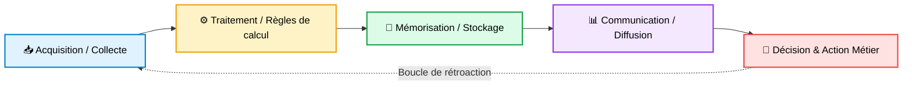

### Distinction fondamentale : SI vs Système Informatique

* **Système Informatique :** Composé exclusivement d'éléments matériels (serveurs, réseaux, routeurs) et logiciels (SGBD, OS, applications, scripts). C'est le support technique opérationnel.
* **Système d'Information (SI) :** Englobe le système informatique, mais intègre impérativement **la dimension humaine** (utilisateurs, gestionnaires, clients), **les processus métier** (procédures d'achat, de facturation, logistique) et **la gouvernance organisationnelle**.

---

## 1.2 Définition de l'Architecture SI et Architecture d'Entreprise (EA)

L'**Architecture d'Entreprise** (*Enterprise Architecture* ou EA) est la discipline formelle qui organise, structure et documente la cohérence globale d'une entreprise : depuis sa stratégie jusqu'à son exécution technologique.

> **Définition ISO/IEC/IEEE 42010 :**
> *"L'architecture est l'organisation fondamentale d'un système incarnée par ses composants, leurs relations entre eux et avec l'environnement, ainsi que les principes guidant sa conception et son évolution."*

L'architecture SI répond à un dilemme permanent : **concilier la pérennité du long terme (stabilité, sécurité) avec l'agilité du court terme (besoins business immédiats)**.

---

## 1.3 Les différents métiers de l'Architecte

Dans les grandes organisations, le rôle d'architecte se décline en 4 spécialités complémentaires :

| Rôle                                                        | Périmètre d'intervention                                                                   | Horizon temporel | Interlocuteurs principaux                     |
| :----------------------------------------------------------- | :------------------------------------------------------------------------------------------- | :--------------- | :-------------------------------------------- |
| **Enterprise Architect (EA)** / **Urbaniste SI** | Vision globale transversale du SI de l'entreprise                                            | 3 à 5 ans       | Direction Générale, DSI, Directeurs Métier |
| **Solution Architect**                                 | Conception d'une solution applicative complète bout en bout répondant à un besoin métier | 1 à 2 ans       | Product Owners, Chefs de projet, Leads Tech   |
| **Software Architect**                                 | Conception interne du code, design patterns, modularité, performance logicielle             | Projet en cours  | Développeurs, Tech Leads, QA                 |
| **Infrastructure / Cloud Architect**                   | Réseaux, plateformes Cloud, virtualisation, dimensionnement matériel, sécurité réseau   | 1 à 3 ans       | Équipes Ops, DevOps, RSSI, SysAdmins         |

---

## 1.4 Les Objectifs Stratégiques de l'Architecture

### 1.4.1 L'Alignement Métier-IT (Business-IT Alignment)

Formalisé par **Henderson & Venkatraman (1993)** dans le *Strategic Alignment Model (SAM)*, l'architecture doit synchroniser quatre domaines :

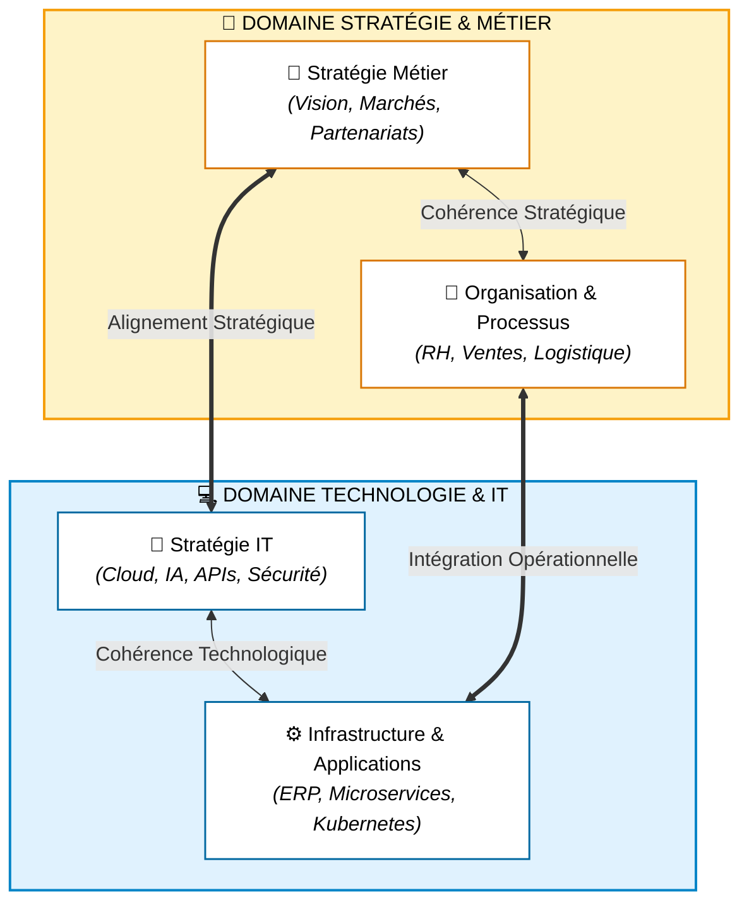

### 1.4.2 TCO (Total Cost of Ownership) & ROI

* **CAPEX (Capital Expenditures) :** Dépenses d'investissement initiales (achat de serveurs, licences perpétuelles).
* **OPEX (Operational Expenditures) :** Dépenses récurrentes de fonctionnement (abonnements SaaS, consommation Cloud au CPU/heure, infogérance).
* L'architecture doit réduire le coût global de possession en évitant les redondances applicatives (ex: avoir 3 CRM différents dans des filiales distinctes).

### 1.4.3 La Dette Technique et l'Obsolescence

La dette technique désigne le surcoût futur engendré par le choix d'une solution de contournement rapide ("quick and dirty") au détriment d'une architecture saine et modulaire.

* Intérêts de la dette : chaque évolution prend 2 à 5 fois plus de temps.
* Risque de faillite technique : impossibilité de faire évoluer le système sans tout casser.

---

# Module 2 : Méthodologies & Cadres de Référence (Frameworks)

## 2.1 La démarche d'Urbanisation du SI (L'Approche Française)

Inspirée par la planification urbaine des villes (Christoph, Sassoon, Longépé), l'urbanisation part du constat qu'**on ne rase pas une métropole pour construire un nouveau quartier ; on la fait évoluer par blocs cohérents**.

### 2.1.1 La Métaphore de la Ville

| Concept Urbain                               | Équivalent dans le Système d'Information | Rôle dans l'Architecture SI                            |
| :------------------------------------------- | :----------------------------------------- | :------------------------------------------------------ |
| **Territoire / Métropole**            | **Ensemble du SI d'Entreprise**      | Périmètre complet de gouvernance                      |
| **Zone d'activité**                   | **Zone Fonctionnelle**               | Découpage macro (ex: Zone Vente, Zone Finance)         |
| **Quartier**                           | **Quartier Fonctionnel**             | Regroupement de fonctions cohérentes (ex: Facturation) |
| **Îlot**                              | **Bloc Fonctionnel Élémentaire**   | Responsable d'une tâche précise (ex: Calcul TVA)      |
| **Réseaux (Eau, Gaz, Électricité)** | **Bus d'Échange / Middleware**      | Réseau d'échanges d'APIs, Kafka, ESB                  |
| **Plan Local d'Urbanisme (PLU)**       | **Règles d'Urbanisme & POS**        | Standards d'intégration et politiques d'urbanisation   |

### 2.1.2 Les Principes d'Urbanisme

1. **Forte cohésion interne :** Un bloc accomplit une et une seule mission fonctionnelle bien identifiée.
2. **Faible couplage externe :** Deux blocs ne communiquent jamais par accès direct à leurs bases de données respectives, mais uniquement via des interfaces formalisées (APIs, contrats de messages).
3. **Non-redondance :** Chaque donnée possède un bloc unique qui en est le maître légitime (*Système d'enregistrement* ou *System of Record*).
4. **Indépendance des couches :** Modifier la couche technique (migrer de MySQL à PostgreSQL) ne doit impacter ni la couche applicative ni la couche métier.

---

## 2.2 TOGAF (The Open Group Architecture Framework)

TOGAF est le standard international le plus utilisé dans les grandes entreprises pour conduire des projets d'architecture globale.

### 2.2.1 Les 4 Piliers BDAT de TOGAF

1. **Business Architecture (Architecture Métier) :** Définit la stratégie d'entreprise, les capacités métier, les processus, la structure organisationnelle.
2. **Data Architecture (Architecture des Données) :** Structure des actifs de données logiques et physiques, gouvernance de la donnée.
3. **Application Architecture (Architecture Applicative) :** Plan de chaque application à déployer, interactions entre systèmes sans s'attacher au code interne.
4. **Technology Architecture (Architecture Technique) :** Capacités matérielles, logicielles d'infrastructure, réseaux, Cloud, OS, middleware.

### 2.2.2 La Roue ADM (Architecture Development Method)

L'ADM est le cœur opérationnel itératif de TOGAF :

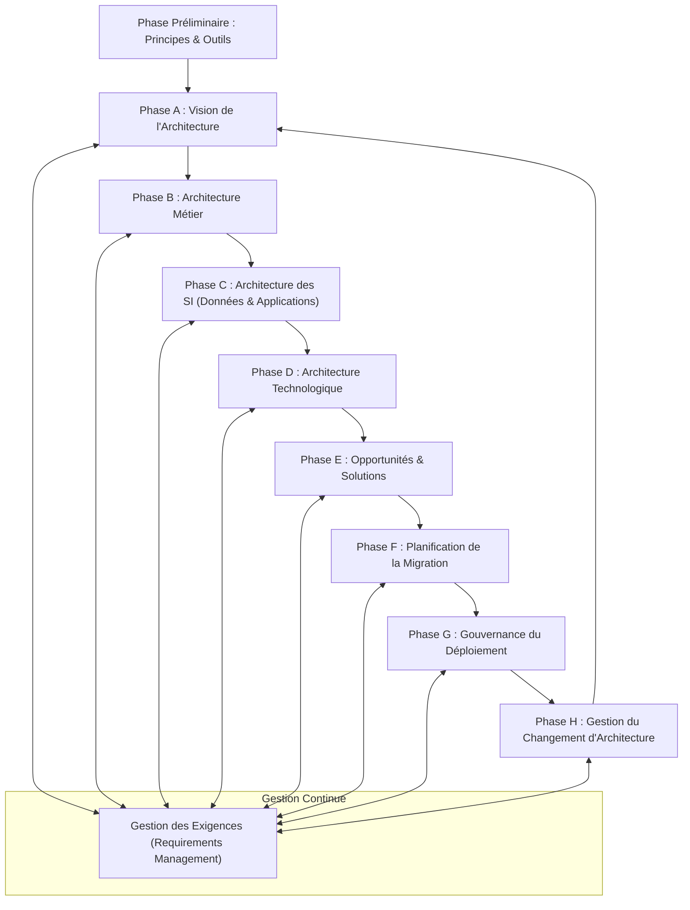

---

## 2.3 Le Cadre de Zachman (Zachman Framework)

Proposé par John Zachman chez IBM en 1987, c'est une **matrice taxonomique bidimensionnelle (6 x 6)** permettant de classifier l'ensemble des artefacts d'un SI sans imposer de méthode séquentielle :

* **Les 6 Colonnes (Les Questions Fondamentales) :**

  1. **Quoi (What) :** Les données (Modèles conceptuels, logiques, physiques de données).
  2. **Comment (How) :** Les fonctions et processus (Diagrammes de flux, cas d'utilisation, spécifications).
  3. **Où (Where) :** La distribution géographique et réseau (Sites, topologies, adresses IP).
  4. **Qui (Who) :** Les personnes et organisations (Acteurs, rôles, RACI, sécurité d'accès).
  5. **Quand (When) :** Le temps (Fréquences d'exécution, ordonnancement, états système).
  6. **Pourquoi (Why) :** Les motivations et objectifs stratégiques (Règles métier, KPI, ROI).
* **Les 6 Lignes (Les Perspectives des Acteurs) :**

  1. *Actionnaire / Planificateur :* Contexte global & Vision.
  2. *Propriétaire Métier :* Modèle conceptuel du métier.
  3. *Architecte / Concepteur :* Modèle logique du système.
  4. *Ingénieur / Bâtisseur :* Modèle physique et technologique.
  5. *Sous-traitant / Intégrateur :* Composants détaillés et code.
  6. *Utilisateur final :* Système fonctionnel en exploitation.

---

## 2.4 La Norme ISO/IEC/IEEE 42010

Standard mondial régissant la description des architectures :

* **Stakeholder (Partie prenante) :** Personne ou groupe ayant un intérêt dans le système (ex: RSSI, DAF, Développeur).
* **Concern (Préoccupation) :** Sujet d'attention critique pour une partie prenante (sécurité, latence, coût, conformité).
* **Viewpoint (Point de vue) :** Convention de formalisation fixant la notation, les règles et types de modèles appropriés pour traiter un ensemble de préoccupations (ex: Vue Sécurité, Vue Déploiement).
* **View (Vue) :** Représentation du système selon un point de vue précis pour une partie prenante donnée.

---

# Module 3 : Modélisation et Cartographie du SI

## 3.1 Cartographie des Processus Métier avec BPMN 2.0

BPMN (*Business Process Model and Notation*) normalisé par l'OMG est le standard de référence pour modéliser les processus opérationnels.

### Les Composants Clés de BPMN :

1. **Flow Objects :**
   * *Événements (Cercles) :* Début (vert fin), Intermédiaire (double cercle), Fin (cercle gras).
   * *Activités (Rectangles aux coins arrondis) :* Tâches utilisateur, tâches automatiques (Service Task), sous-processus.
   * *Passerelles (Losanges) :* Exclusive (XOR - choix unique), Parallèle (AND - branches simultanées), Inclusive (OR - une ou plusieurs branches).
2. **Swimlanes (Lignes d'eau) :**
   * *Pool :* Représente une organisation ou entité juridique participante (ex: "Client", "Banque").
   * *Lane :* Sous-division au sein d'une pool (ex: "Service Commercial", "Service Comptabilité").
3. **Connecting Objects :** Flux de séquence (flèche pleine intra-pool), Flux de message (flèche pointillée inter-pools).

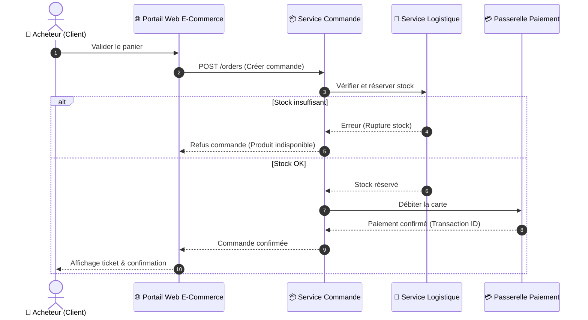

---

## 3.2 Modélisation d'Architecture d'Entreprise avec ArchiMate 3.x

Géré par The Open Group, ArchiMate offre un métamodèle unifié connectant la stratégie aux serveurs physiques avec des codes couleurs stricts :

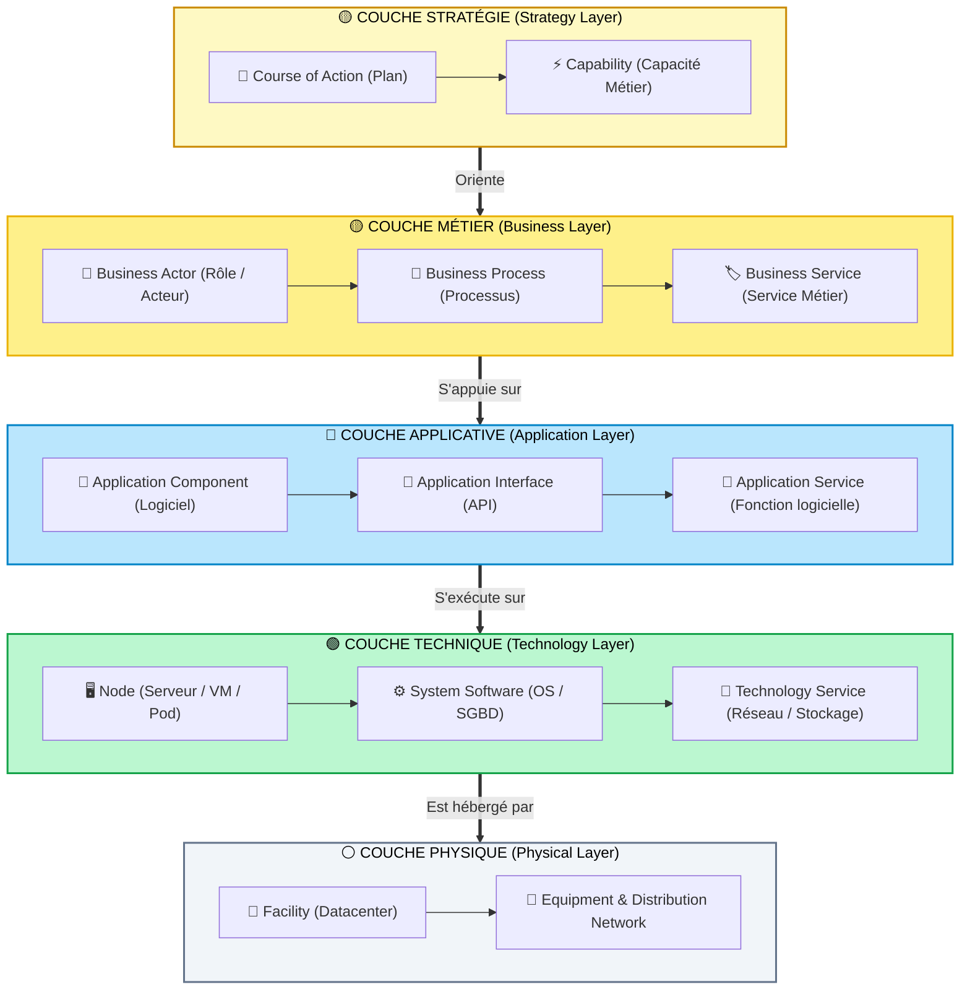

---

## 3.3 Les 4 Vues Canoniques de l'Urbanisme

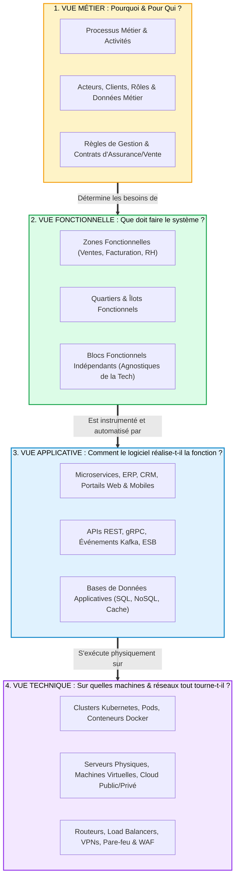

---

# Module 4 : Paradigmes & Styles d'Architecture Logicielle et Applicative

## 4.1 Monolithe vs Architecture Distribuée

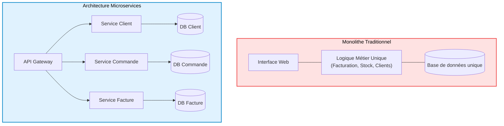

### Matrice Comparative :

| Caractéristique                      | Architecture Monolithique                                     | Architecture Microservices                                |
| :------------------------------------ | :------------------------------------------------------------ | :-------------------------------------------------------- |
| **Complexité de déploiement** | Simple (un seul binaire/jar/war à déployer)                 | Complexe (nécessite Kubernetes, CI/CD avancée)          |
| **Scalabilité**                | Globale (on duplique tout le monolithe)                       | Granulaire (on scale uniquement le service surchargé)    |
| **Couplage**                    | Fort (risque de code spaghettis et dépendances cachées)     | Faible (communication via des contrats d'API stricts)     |
| **Isolation des pannes**        | Faible (un memory leak dans un module plante tout le serveur) | Forte (un crash du service d'avis n'empêche pas l'achat) |
| **Cohérence des données**     | Transactionnelle immédiate (ACID facile)                     | Éventuelle (Transactions distribuées Saga nécessaires) |

---

## 4.2 Architecture Orientée Services (SOA) & ESB

### Les principes de la SOA :

1. **Contrat standardisé :** Définition formelle (WSDL/XSD en SOAP, OpenAPI en REST).
2. **Couplage lâche :** Les consommateurs ne connaissent pas l'implémentation interne du fournisseur.
3. **Abstraction :** Masque la complexité des systèmes sous-jacents.
4. **Réutilisabilité :** Un service client sert à la fois au web, au mobile et aux agences physiques.
5. **Composabilité :** Les services atomiques s'assemblent pour créer des services composites.

---

## 4.3 Architecture Orientée Événements (EDA) : CQRS & Event Sourcing

Dans une EDA, les composants ne s'appellent pas directement de manière synchrone : ils réagissent à des **événements** (changements d'état significatifs du système).

### Le Pattern CQRS (Command Query Responsibility Segregation) :

Séparation stricte de la **Commande** (écriture, forte cohérence) et de la **Requête** (lecture, optimisée pour l'affichage) :

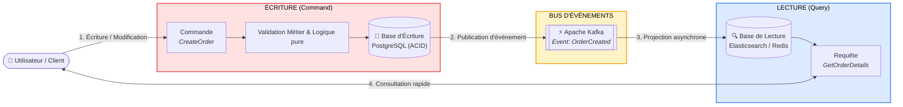

---

## 4.4 Architectures Propres (Clean Architecture & Hexagonale)

Conçue par Alistair Cockburn (Architecture Hexagonale) et Robert C. Martin (Clean Architecture), la règle d'or est **l'indépendance de la logique métier vis-à-vis des frameworks, bases de données et interfaces graphiques**.

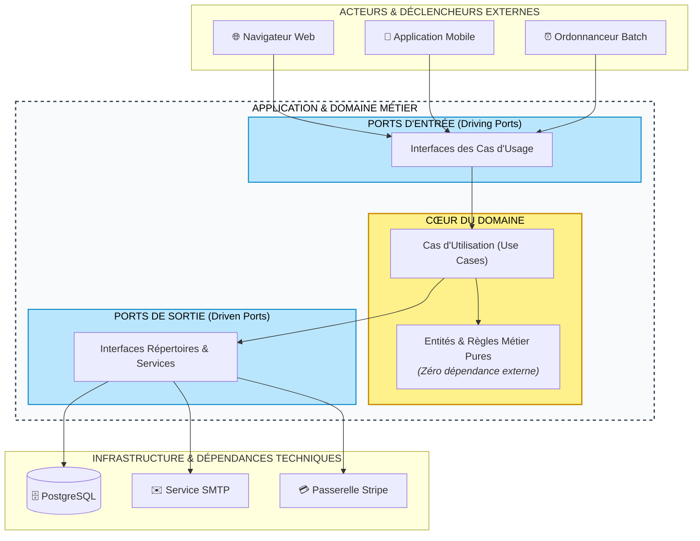

---

# Module 5 : Architecture des Données (Data Architecture)

## 5.1 Gestion des Données de Référence (MDM)

Dans une grande entreprise, les données critiques (clients, produits, fournisseurs) sont dispersées dans des dizaines d'applications hétérogènes.

* **Problème :** Incohérence, doublons, divergence d'adresses.
* **Solution MDM :** Mettre en place un **Référentiel Unique** établissant le **Golden Record** (la version officielle de référence vérifiée) diffusé aux autres applications.

---

## 5.2 Du Relationnel (ACID) au NoSQL (BASE & Théorème CAP)

### Théorème CAP (Eric Brewer) :

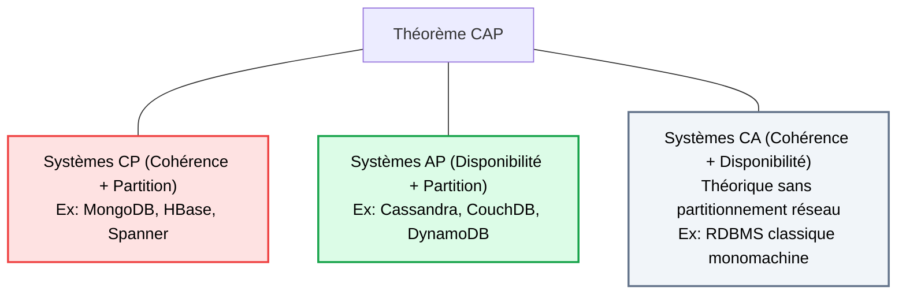

---

## 5.3 L'Évolution du Décisionnel : De l'Entrepôt au Data Mesh

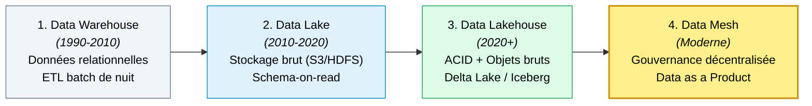

---

# Module 6 : Architecture d'Intégration & Échanges Inter-Applicatifs

## 6.1 Panorama des Styles d'APIs

| Protocole                | Modèle de transport          | Format des données         | Cas d'usage recommandé                                                        |
| :----------------------- | :---------------------------- | :-------------------------- | :----------------------------------------------------------------------------- |
| **REST (OpenAPI)** | HTTP/1.1 ou HTTP/2            | JSON, XML                   | APIs publiques, CRUD standard, intégration universelle                        |
| **GraphQL**        | HTTP (généralement POST)    | JSON                        | Applications mobiles & Frontends complexes (évite over/under-fetching)        |
| **gRPC**           | HTTP/2 binaire                | Protocol Buffers (Protobuf) | Communication inter-microservices à très haute performance et faible latence |
| **WebSockets**     | TCP bidirectionnel persistant | Binaire ou Texte            | Tableaux de bord boursiers en direct, chats, télémétrie temps réel         |
| **Webhooks**       | HTTP POST asynchrone          | JSON                        | Notification push d'événement (ex: Stripe validant un paiement)              |

---

## 6.2 API Management (APIM) & Service Mesh

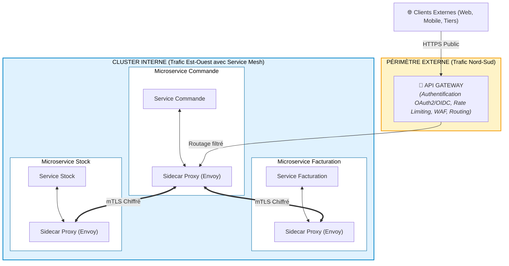

---

# Module 7 : Architecture d'Infrastructure, Cloud & Sécurité

## 7.1 Modèles de Service Cloud & Responsabilité Partagée

| Couche d'Infrastructure                 | Sur site (On-Premise) | IaaS (AWS EC2, GCE) | PaaS (App Engine, Heroku) | SaaS (Salesforce, M365) |  Serverless (FaaS)  |
| :-------------------------------------- | :-------------------: | :-----------------: | :-----------------------: | :---------------------: | :-----------------: |
| **Données & Accès**             |     🏢 Entreprise     |    🏢 Entreprise    |       🏢 Entreprise       |      🏢 Entreprise      |    🏢 Entreprise    |
| **Code Applicatif**               |     🏢 Entreprise     |    🏢 Entreprise    |       🏢 Entreprise       |   ☁️ Cloud Provider   |    🏢 Entreprise    |
| **Runtime & Frameworks**          |     🏢 Entreprise     |    🏢 Entreprise    |    ☁️ Cloud Provider    |   ☁️ Cloud Provider   | ☁️ Cloud Provider |
| **Système d'Exploitation (OS)**  |     🏢 Entreprise     |    🏢 Entreprise    |    ☁️ Cloud Provider    |   ☁️ Cloud Provider   | ☁️ Cloud Provider |
| **Virtualisation & Hyperviseur**  |     🏢 Entreprise     | ☁️ Cloud Provider |    ☁️ Cloud Provider    |   ☁️ Cloud Provider   | ☁️ Cloud Provider |
| **Serveurs & Stockage Physique**  |     🏢 Entreprise     | ☁️ Cloud Provider |    ☁️ Cloud Provider    |   ☁️ Cloud Provider   | ☁️ Cloud Provider |
| **Réseau physique & Datacenter** |     🏢 Entreprise     | ☁️ Cloud Provider |    ☁️ Cloud Provider    |   ☁️ Cloud Provider   | ☁️ Cloud Provider |

---

## 7.2 Architecture de Sécurité : Le Modèle Zero Trust (NIST SP 800-207)

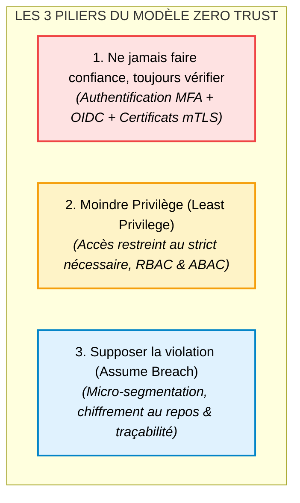

---

# Module 8 : Gouvernance, Trajectoire SI et Schéma Directeur (SDSI)

## 8.1 Élaboration du Schéma Directeur des SI (SDSI)

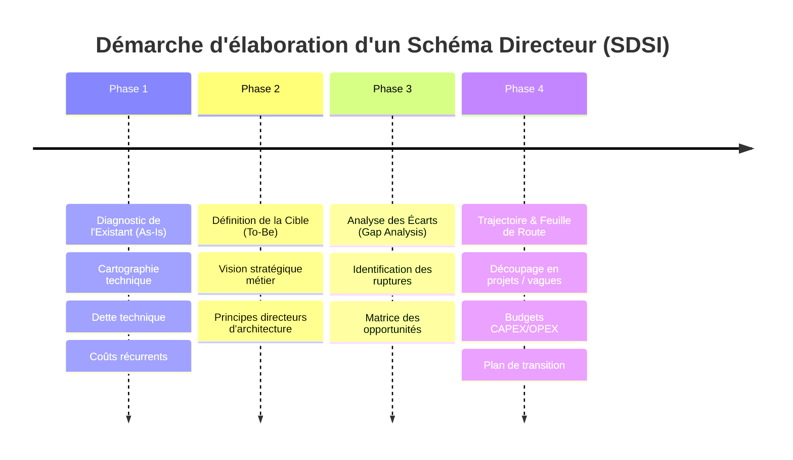

---

## 8.2 Rationalisation du Portefeuille Applicatif : Le Modèle TIME du Gartner

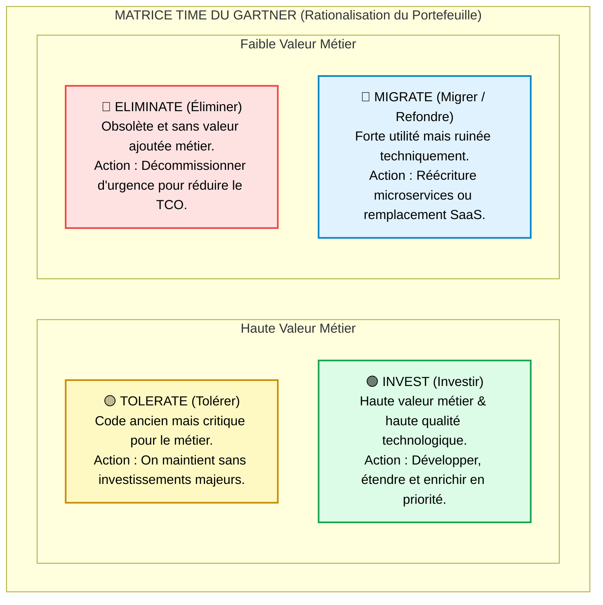

---

# Module 9 : Étude de Cas Fil Conducteur & Exercices d'Examen

## Cas Pratique Fil Conducteur : Modernisation de "BankNova"

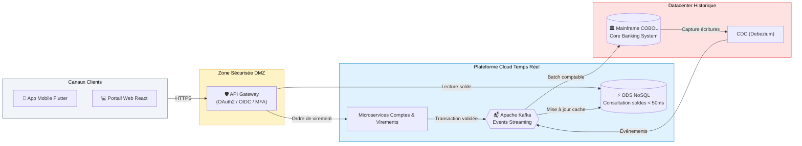

---

## QCM & Questions Ouvertes d'Évaluation Master (Avec Corrigés)

### Question 1 (QCM) :

Dans TOGAF ADM, quelle phase s'occupe de concevoir l'architecture des données et des applications ?

* A) Phase A
* B) Phase B
* C) Phase C
* D) Phase D

> **Réponse : C.** La Phase C est l'Architecture des Systèmes d'Information, scindée en *Data Architecture* et *Application Architecture*.

### Question 2 (Analyse d'Architecture) :

*Un développeur propose que le service de Facturation écrive directement dans la table `Commande` du service Commande pour aller plus vite.***Question :** Que lui répond l'Architecte Urbaniste du SI ? Justifiez avec deux principes fondamentaux vus en cours.

> **Réponse attendue :**L'architecte **refuse formellement** cette conception.
>
> 1. **Violation du couplage faible et de l'encapsulation :** Le service Commande doit être le seul maître légitime (*System of Record*) de son modèle de données. Tout accès direct par un composant externe viole la cohésion interne et crée un couplage fort au niveau de la structure SQL. Si le service Commande change de schéma, le service Facturation casse.
> 2. **Règle d'intégration d'urbanisme :** La communication doit impérativement s'effectuer via une interface contractuelle formalisée (API REST synchrone ou message/événement asynchrone dans un broker).

---

*Fin du document de cours — Référentiel Master SI.*
