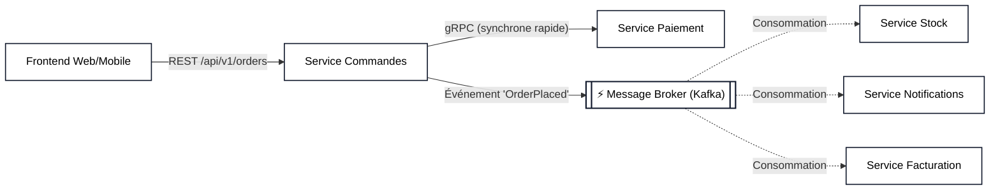
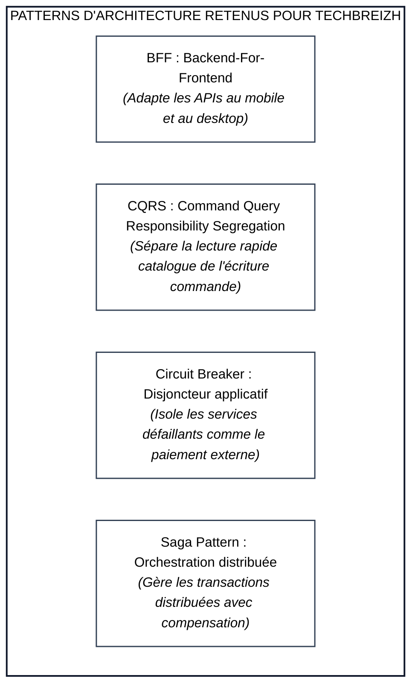
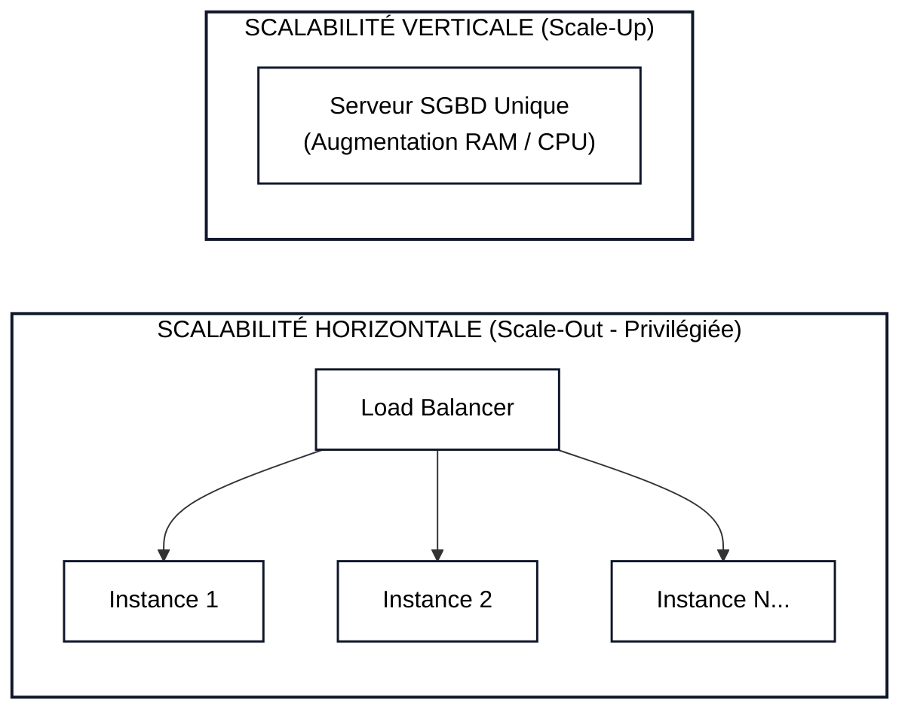
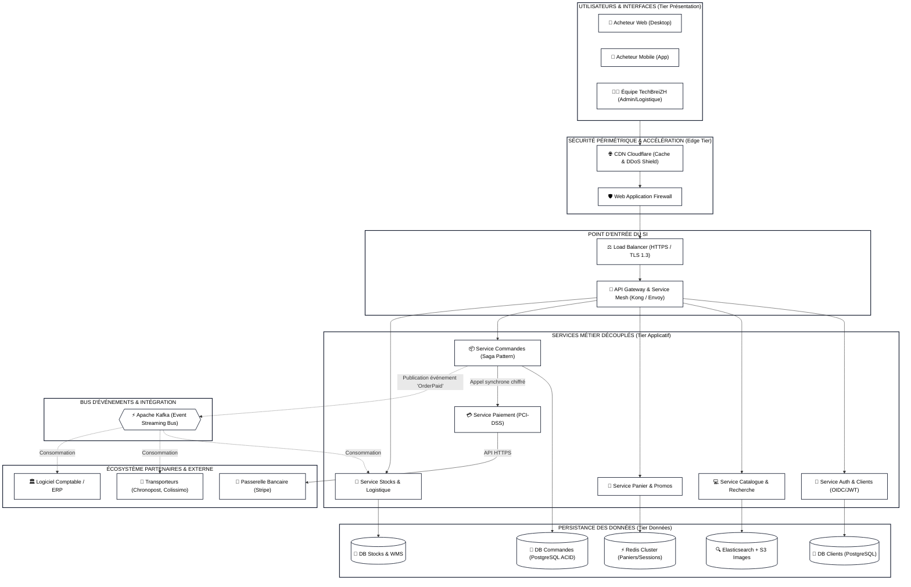

# Rapport d'Étude de Cas : Conception du Système d'Information de TechBreiZH

**Établissement :** CFA INSTA — Paris 2ème
**Formation :** Master 1 Systèmes d'Information (Master SI)
**Matière :** Architecture des Systèmes d'Information
**Document analysé :** EDC1.pdf — Étude de Cas : Conception du SI de TechBreiZH
**Rôle :** Consultants experts en Architecture des Systèmes d'Information

---

## 📑 Sommaire

1. [Contexte et Objectifs Stratégiques](#1-contexte-et-objectifs-stratégiques)
2. [Partie 1 : Identification des Composants du SI](#partie-1--identification-des-composants-du-si)
3. [Partie 2 : Séparation des Couches (3-Tiers / N-Tiers)](#partie-2--séparation-des-couches-3-tiers--n-tiers)
4. [Partie 3 : Découplage des Composants &amp; Contrats d&#39;APIs](#partie-3--découplage-des-composants--contrats-dapis)
5. [Partie 4 : Modularité Fonctionnelle et Technique](#partie-4--modularité-fonctionnelle-et-technique)
6. [Partie 5 : Utilisation de Patterns d&#39;Architecture](#partie-5--utilisation-de-patterns-darchitecture)
7. [Partie 6 : Application des Standards et Bonnes Pratiques (TOGAF, ITIL, ISO)](#partie-6--application-des-standards-et-bonnes-pratiques-togaf-itil-iso)
8. [Partie 7 : Scalabilité et Sécurité du SI](#partie-7--scalabilité-et-sécurité-du-si)
9. [Partie 8 : Performance et Gouvernance du SI](#partie-8--performance-et-gouvernance-du-si)
10. [Partie 9 : Intégration Partenaires et Tendances Technologiques](#partie-9--intégration-partenaires-et-tendances-technologiques)
11. [Schéma d&#39;Architecture Globale du SI TechBreiZH](#schéma-darchitecture-globale-du-si-techbreizh)
12. [Synthèse Finale : Alignement Stratégique &amp; Croissance Future](#synthèse-finale--alignement-stratégique--croissance-future)

---

## 1. Contexte et Objectifs Stratégiques

**TechBreiZH** est une entreprise en forte expansion spécialisée dans le commerce électronique de produits technologiques (matériel informatique, gadgets connectés, composants high-tech).

### Les défis identifiés :

* **Pics de charge saisonniers :** Black Friday, soldes, lancements de nouveaux processeurs/cartes graphiques générant des congestions sur le catalogue et le paiement.
* **Complexité logistique :** Gestion des stocks en flux tendu, expéditions multi-transporteurs, suivi en temps réel.
* **Expérience utilisateur (UX) :** Nécessité d'une interface ultra-rapide, réactive, disponible 24/7 sur web et mobile.
* **Sécurité & Conformité :** Protection des données bancaires (PCI-DSS) et données personnelles (RGPD), prévention des attaques DDoS et tentatives de fraude.
* **Dette technique potentielle :** Nécessité d'abandonner une architecture monolithique vieillissante au profit d'une architecture modulaire, découplée et évolutive.

---

## Partie 1 : Identification des Composants du SI

Pour soutenir l'activité e-commerce de TechBreiZH, le SI repose sur les 5 dimensions fondamentales d'un Système d'Information :

| Catégorie                         | Composants Clés Retenus                                                                                                                                                                                                                                                                                                                                                                                                                                                                                                                  | Justification & Rôle dans l'Écosystème TechBreiZH                                                                                                 |
| :--------------------------------- | :---------------------------------------------------------------------------------------------------------------------------------------------------------------------------------------------------------------------------------------------------------------------------------------------------------------------------------------------------------------------------------------------------------------------------------------------------------------------------------------------------------------------------------------- | :--------------------------------------------------------------------------------------------------------------------------------------------------- |
| **1. Logiciels (Software)**  | • **Front-office E-Commerce :** SPA/SSR (Next.js/React).• **Microservices Métier :** Services Catalogue, Commande, Panier, Paiement, Stock, Facturation.• **ERP / WMS :** Gestion logistique, inventaire d'entrepôt et approvisionnements.• **CRM & Service Client :** Gestion relation client, SAV, billetterie d'incidents (ex: Zendesk / HubSpot).• **SGBD & Caches :** PostgreSQL (données transactionnelles), Redis (sessions & caches), Elasticsearch (recherche catalogue instantanée).     | Permet d'offrir une interface réactive aux acheteurs tout en orchestrant automatiquement les flux d'affaires (ventes, expéditions, comptabilité). |
| **2. Matériels (Hardware)** | • **Serveurs Cloud Virtuels / Instances de Calcul :** Noeuds Kubernetes (CPUs/vCPUs scalables).• **Stockage Haute Vitesse :** Volumes NVMe (SAN cloud) pour les SGBD.• **Terminaux Entrepôt :** Scanneurs de code-barres / terminaux radiofréquence (RF) pour les préparateurs de commandes.• **Postes de travail sécurisés :** Équipements du personnel administratif et support client.                                                                                                               | Fournit la puissance de calcul brute élastique et la fiabilité matérielle nécessaire pour éliminer tout point de panne unique (*SPOF*).       |
| **3. Réseaux (Network)**    | • **CDN (Content Delivery Network - Cloudflare/Fastly) :** Mise en cache globale des assets statiques (images produits, CSS, JS).• **Load Balancers (Équilibrateurs de charge) :** Répartition de trafic HTTP/HTTPS entrant (AWS ALB / Nginx).• **VPC (Virtual Private Cloud) & Sous-réseaux :** Isolation DMZ (front), sous-réseau applicatif privé, sous-réseau données strictement étanche.• **VPN IPsec / Bastions :** Accès sécurisé des administrateurs et des sites physiques (entrepôts). | Garantit un temps de réponse mondial inférieur à 50 ms et isole les données sensibles d'Internet.                                                |
| **4. Données (Data)**       | • **Données Produits :** Fiches techniques, prix, compatibilités matérielles, avis.• **Données Transactionnelles :** Paniers, commandes, factures, transactions bancaires (ACID).• **Données Clients & Comptes :** Profils, adresses de livraison, historique, préférences marketing.• **Données Télémétriques & Logs :** Traces d'accès, métriques d'audit, détection d'anomalies de sécurité.                                                                                               | Actif le plus précieux de l'entreprise ; doit garantir intégrité, cohérence stricte, fraîcheur et conformité RGPD.                             |
| **5. Utilisateurs (People)** | • **Clients finaux (B2C & B2B) :** Acheteurs naviguant et commandant en ligne.• **Opérateurs Logistiques / Entrepôt :** Préparation, emballage, expédition.• **Service Client & SAV :** Traitement des retours, remboursements, réclamations.• **Gestionnaires Métier / Auteurs Catalogue :** Définition des promotions, référencement des nouveautés.• **Équipes IT / DevOps / RSSI :** Exploitation, maintien en conditions opérationnelles (MCO), sécurité.                           | Le SI doit adapter ses interfaces et ses règles d'habilitation (RBAC) aux besoins spécifiques de chaque profil d'acteur.                           |

---

## Partie 2 : Séparation des Couches

La séparation en couches (architecture N-Tiers) garantit l'indépendance des cycles de vie et la maintenabilité.

```mermaid
flowchart TD
    subgraph L1["1. COUCHE PRÉSENTATION (Tier 1 : Frontend)"]
        Web["🖥️ Application Web (Next.js / SSR)"]
        Mobile["📱 Application Mobile (Flutter / iOS / Android)"]
        BackOffice["🛠️ Interface Back-Office Administrateur"]
    end

    subgraph L2["2. COUCHE LOGIQUE MÉTIER (Tier 2 : Traitements & Services)"]
        APIGW["🚪 API Gateway & Authentification (OIDC/JWT)"]
        S1["📦 Service Catalogue & Recherche"]
        S2["🛒 Service Panier & Tarification"]
        S3["💳 Service Commande & Paiement"]
        S4["🏬 Service Stock & Expédition"]
        APIGW --> S1
        APIGW --> S2
        APIGW --> S3
        APIGW --> S4
    end

    subgraph L3["3. COUCHE DONNÉES (Tier 3 : Persistance & Intégration)"]
        RDBMS[("💾 SGBD Relationnel (PostgreSQL)") - Transactions]
        Cache[("⚡ Cache en Mémoire (Redis)") - Sessions/Paniers]
        Search[("🔍 Index Moteur de Recherche (Elasticsearch)") - Filtres]
        Legacy[("🏛️ ERP / Logiciel Comptable Partenaire")]
    end

    L1 ==>|"HTTPS / JSON REST / GraphQL"| APIGW
    S1 --> Search
    S2 --> Cache
    S3 --> RDBMS
    S4 --> Legacy

    classDef default fill:#ffffff,stroke:#0f172a,stroke-width:1.5px,color:#000000;
    style L1 fill:#ffffff,stroke:#0f172a,stroke-width:2px,color:#000000
    style L2 fill:#ffffff,stroke:#0f172a,stroke-width:2px,color:#000000
    style L3 fill:#ffffff,stroke:#0f172a,stroke-width:2px,color:#000000
```

### Contenu détaillé de chaque couche :

1. **Couche Présentation :**
   * *Composants :* Web store client, portail mobile, dashboard logistique/administration.
   * *Rôle :* Restitution visuelle, ergonomie, validation de surface des formulaires, gestion de l'affichage adaptatif (*responsive design*).
2. **Couche Métier (Application / Domaine) :**
   * *Composants :* API Gateway, services métier autonomes, moteurs de calculs de remises/TVA, vérification de solvabilité, orchestration de workflows de commande.
   * *Rôle :* Appliquer rigoureusement les règles de gestion d'entreprise sans se soucier du moyen d'affichage ni du moteur SQL sous-jacent.
3. **Couche Données :**
   * *Composants :* Bases PostgreSQL répliquées (Master-Replica), caches Redis, clusters de recherche Elasticsearch, systèmes de fichiers objets (S3 pour photos produits).
   * *Rôle :* Garantir l'atomicité, la consistance, l'isolation, la durabilité (ACID) des transactions financières et optimiser la vitesse de lecture.

### Pourquoi cette structure facilite-t-elle l'évolution et la maintenance ?

* **Évolutivité indépendante :** L'équipe frontend peut refondre entièrement l'application mobile ou le site Web sans toucher à une seule ligne de code des règles métier ou de la base de données.
* **Testabilité accrue :** La logique métier peut être testée unitairement par des tests automatisés sans dépendre d'une base de données réelle ou d'une interface graphique.
* **Maintenance ciblée :** Une mise à niveau du moteur de base de données (ex: migration de version PostgreSQL) est totalement transparente pour les utilisateurs du site web.

---

## Partie 3 : Découplage des Composants

### Comment concevoir un SI avec des composants indépendants ?

Le découplage repose sur 3 piliers techniques :

1. **Contrats d'interface stricts (API First) :** Chaque composant expose ses capacités uniquement via des contrats normalisés (OpenAPI / Swagger pour REST, schémas Protobuf pour gRPC).
2. **Bases de données dédiées (*Database-per-service*) :** Aucun service n'a le droit d'accéder directement à la base de données d'un autre service.
3. **Communication asynchrone par événements (*Event-Driven Architecture*) :** Utilisation d'un bus de messages (Apache Kafka ou RabbitMQ) pour notifier les changements d'état sans bloquer l'émetteur.

### Services et APIs nécessaires pour le e-commerce TechBreiZH :



* **API Catalogue (`GET /products/{id}`, `GET /search`) :** Consultation des références et fiches techniques.
* **API Panier (`POST /cart/items`, `DELETE /cart/items/{id}`) :** Gestion des articles en session.
* **API Commande (`POST /orders`) :** Initialisation et validation du panier en commande ferme.
* **API Paiement (`POST /payments/charge`) :** Communication sécurisée avec la passerelle bancaire (Stripe/Payline).
* **API Stock (`PATCH /inventory/reserve`) :** Réservation temporaire puis décrémentation des stocks physiques.
* **API Livraison (`POST /shipments/track`) :** Génération des étiquettes et communication avec les transporteurs (Chronopost, Colissimo, Mondial Relay).

### Avantages du découplage :

* **Tolérance aux pannes (*Fault Isolation*) :** Si le service d'envoi d'e-mails ou le service des avis clients tombe en panne, le client peut quand même passer sa commande.
* **Scalabilité élastique et sélective :** Lors du Black Friday, le service Catalogue et le Panier reçoivent 50 fois plus de trafic que le service Facturation ; on peut alors scaler uniquement ces deux services sans surpayer l'infrastructure globale.
* **Autonomie des équipes de développement :** Différentes équipes peuvent travailler en parallèle avec des technologies adaptées (ex: Go pour le service de streaming de stocks, Node.js pour le frontend BFF, Java/Spring Boot pour la facturation).

---

## Partie 4 : Modularité

### Quelles fonctionnalités séparer en modules ?

Pour TechBreiZH, nous préconisons un découpage modulaire basé sur le **Domain-Driven Design (DDD)** avec 6 modules métier autonomes :

| Module                                                           | Responsabilités Métier                                                                                                 | Modèle de Données Associé                                                   |
| :--------------------------------------------------------------- | :----------------------------------------------------------------------------------------------------------------------- | :----------------------------------------------------------------------------- |
| **Module 1 : Gestion du Catalogue & Prix**                 | Référencement des produits high-tech, marques, catégories, gestion des remises et compatibilités.                    | Base documentaire / NoSQL pour la flexibilité des fiches produits techniques. |
| **Module 2 : Gestion des Utilisateurs & Authentification** | Inscriptions, gestion des rôles (clients, admins), conformité RGPD, gestion des adresses.                              | PostgreSQL (chiffrement des mots de passe en Argon2id).                        |
| **Module 3 : Gestion du Panier & Tunnel de Vente**         | Calcul des totaux en direct, application de codes promo, persistance temporaire.                                         | Clé-valeur Redis en mémoire à expiration automatique (TTL).                 |
| **Module 4 : Gestion des Commandes & Factures**            | Cycle de vie de la commande (Créée -> Payée -> En préparation -> Expédiée), génération légale des factures PDF. | PostgreSQL (intégrité relationnelle stricte).                                |
| **Module 5 : Gestion des Stocks & Logistique**             | Réception fournisseur, localisation en entrepôt, inventaire temps réel, alerte rupture.                               | PostgreSQL + files de messages.                                                |
| **Module 6 : Service Après-Vente & Retours (RMA)**        | Demande de retour sous 14 jours, suivi des réparations garanties constructeurs.                                         | SGBD relationnel + stockage fichiers (photos pièces défectueuses).           |

### Justification : En quoi cette modularité permet-elle une gestion plus souple et efficace des ressources SI ?

1. **Optimisation des ressources matérielles :** Allocation fine du CPU et de la RAM en fonction de la charge réelle de chaque module au lieu d'un monolithe surdimensionné.
2. **Déploiements continus à faible risque :** Déployer une mise à jour sur le module SAV ne présente aucun risque d'interruption de service sur le module Paiement.
3. **Réutilisabilité :** Le module Calcul de TVA ou Authentification peut être directement réutilisé si TechBreiZH décide d'ouvrir une place de marché (*marketplace*) ou une application B2B dédiée aux revendeurs.

---

## Partie 5 : Utilisation de Patterns d'Architecture

Pour garantir un SI évolutif, performant et résilient, nous combinons des patrons d'architecture éprouvés :



### 1. Pattern Microservices pour le Cœur Métier :

* **Pourquoi ?** Remplace l'ancien monolithe. Permet à chaque domaine (Commande, Stock, Client) de vivre sa propre vie technique et de s'adapter aux hausses de charge massives.

### 2. Pattern BFF (Backend-For-Frontend) :

* **Pourquoi ?** Un client sur smartphone en 4G n'a pas les mêmes besoins en bande passante qu'un utilisateur sur un PC de bureau avec écran 4K. Le BFF agrège les appels vers les microservices et renvoie un payload JSON optimisé et allégé.

### 3. Pattern Circuit Breaker (Disjoncteur - ex: Resilience4j) :

* **Pourquoi ?** Si la passerelle de paiement bancaire extérieure ralentit ou ne répond plus, le disjoncteur "s'ouvre" immédiatement pour éviter d'épuiser les threads du serveur de commande. Un message convivial est renvoyé au client au lieu d'un timeout de 60 secondes.

### 4. Pattern Saga (Orchestration de transactions distribuées) :

* **Pourquoi ?** En microservices, il n'existe pas de transaction SQL `BEGIN...COMMIT` globale. Le pattern Saga garantit la cohérence :
  1. *Étape 1 :* Réservation du stock.
  2. *Étape 2 :* Débit de la carte bancaire.
  3. *Si le débit échoue :* Déclenchement automatique d'une action compensatoire (annulation de la réservation du stock).

---

## Partie 6 : Application des Standards et Bonnes Pratiques

L'adoption de cadres normatifs reconnus évite l'improvisation et professionnalise l'ingénierie de TechBreiZH :

### 1. TOGAF (The Open Group Architecture Framework) :

* **Rôle :** Aligner la vision de l'entreprise avec le SI grâce à la méthode itérative **ADM (Architecture Development Method)**.
* **Bénéfice :** Permet de documenter la trajectoire du SI (de l'état existant *As-Is* vers la cible *To-Be*) selon les 4 dimensions **BDAT** : Métier (*Business*), Données (*Data*), Applications (*Application*), et Technologie (*Technology*).

### 2. ITIL v4 (Information Technology Infrastructure Library) :

* **Rôle :** Cadrer la gestion des services informatiques (ITSM).
* **Bénéfice :** Mettre en place des processus formels pour :
  * *Gestion des Incidents :* Résolution rapide des pannes en production avec SLA stricts.
  * *Gestion des Changements :* Validation rigoureuse des déploiements majeurs pour éviter les interruptions pendant les périodes commerciales clés.
  * *Gestion des Problèmes :* Analyse des causes profondes des pannes récurrentes.

### 3. Normes ISO (ISO 27001 & ISO 9001) :

* **ISO/IEC 27001 (Sécurité des Systèmes d'Information) :** Met en œuvre un Système de Management de la Sécurité de l'Information (SMSI) avec analyse des risques, gestion des accès, chiffrement et politique de sauvegarde.
* **ISO 9001 (Management de la Qualité) :** Assure la satisfaction des clients par l'amélioration continue des processus opérationnels et de livraison logicielle.

---

## Partie 7 : Scalabilité et Sécurité du SI

### Stratégie de Scalabilité :



1. **Scalabilité Horizontale (*Scale-Out*) :**
   * Mise en œuvre pour la couche Web et Applicative via **Kubernetes (HPA - Horizontal Pod Autoscaler)**. Dès que l'utilisation CPU/mémoire dépasse 70 %, de nouveaux conteneurs sont créés automatiquement en quelques secondes.
2. **Scalabilité Verticale (*Scale-Up*) & Réplication pour la base de données :**
   * Augmentation ponctuelle des ressources machine du serveur maître PostgreSQL pour absorber les écritures.
   * Déport des lectures sur des **Read Replicas** (réplicas en lecture seule) pour soulager la base primaire.

### Mesures de Sécurité Essentielles :

* **Architecture Zero Trust :** "Ne jamais faire confiance, toujours vérifier". Authentification mutuelle mTLS entre tous les microservices internes.
* **Chiffrement de bout en bout :** Données en transit chiffrées en **TLS 1.3**, données au repos chiffrées en **AES-256** (disques, sauvegardes, bases de données).
* **Sécurité Applicative (OWASP Top 10) :** Protection contre les injections SQL, XSS, CSRF, et utilisation d'un **WAF (Web Application Firewall)** pour bloquer les scanners de vulnérabilités et attaques DDoS.
* **Gestion des Identités et des Accès (IAM & RBAC) :** Principe du moindre privilège pour les employés et utilisation du protocole OAuth 2.0 / OpenID Connect avec jetons JWT signés.
* **Conformité Bancaire PCI-DSS :** Externalisation de la saisie des coordonnées bancaires via des éléments sécurisés hébergés par le prestataire de paiement (Stripe Elements / iFrame sécurisée), évitant à TechBreiZH de stocker des numéros de cartes bancaires sur ses propres serveurs.

---

## Partie 8 : Performance et Gouvernance du SI

### Techniques d'Optimisation de la Performance :

1. **Caching Multi-Niveaux :**
   * *Niveau 1 (Navigateur & Edge CDN) :* Mise en cache des images de composants électroniques, feuilles de style et scripts (TTL longs).
   * *Niveau 2 (Passerelle / Reverse Proxy) :* Cache des réponses HTTP des requêtes publiques fréquentes (ex: Top 10 des ventes).
   * *Niveau 3 (En Mémoire - Redis) :* Mise en cache des résultats de calculs lourds, des stocks disponibles et des sessions utilisateurs.
2. **Équilibrage de Charge (Load Balancing) :**
   * Algorithme *Least Connections* ou *Round Robin* pondéré au niveau de l'Ingress Controller pour répartir équitablement les requêtes sur les pods les moins sollicités.
3. **Optimisation des Requêtes et Asynchronisme :**
   * Indexation fine (B-Tree, GIN) sur les colonnes de recherche SQL.
   * Déchargement des tâches lentes (génération de factures PDF, envoi de mails de confirmation) vers des workers d'arrière-plan asynchrones via des files d'attente.

### Cadre de Gouvernance du SI :

* **Comité d'Architecture (Architecture Review Board - ARB) :** Instance mensuelle validant la conformité technique de tout nouveau composant avec les standards d'urbanisation de l'entreprise.
* **Gestion de la Dette Technique :** Règle des 80/20 imposant d'allouer 20 % du temps de chaque sprint de développement à la résorption de la dette technique et aux mises à jour de sécurité.
* **Supervision & Observabilité (Stack Grafana / Prometheus / OpenTelemetry) :**
  * Suivi des 4 métriques dorées de Google (*Golden Signals*) : Latence, Trafic, Erreurs, Saturation.
  * Alerting automatisé 24/7 vers les ingénieurs d'astreinte en cas de dépassement des seuils critiques de SLA.

---

## Partie 9 : Intégration et Tendances Technologiques

### Outils et Technologies d'Intégration Partenaires :

* **API Gateway d'Entreprise (ex: Kong, Apigee, Traefik) :** Point d'entrée unique gérant le rate-limiting, la validation des clés d'API partenaires, la transformation des formats de données et la journalisation.
* **Webhooks & Bus d'Événements :** Notifications en temps réel envoyées aux partenaires transporteurs et réception des statuts de livraison en temps réel.
* **iPaaS / Middleware d'Intégration :** Pour synchroniser les flux comptables et fiscaux avec l'administration et les banques.

### Tendances Technologiques Pertinentes pour TechBreiZH :

1. **Cloud Native & Serverless :**
   * Utilisation de conteneurs standards gérés par Kubernetes (EKS/GKE) pour éviter l'enfermement propriétaire (*vendor lock-in*) et exécution de fonctions Serverless (FaaS) pour les traitements ponctuels (ex: redimensionnement automatique des photos de produits téléversées).
2. **Intelligence Artificielle (IA) Appliquée au E-Commerce :**
   * *Recommandation Personnalisée :* Moteur d'IA analysant le panier et l'historique pour suggérer des produits complémentaires hautement compatibles (ex: proposer la bonne pâte thermique et la bonne alimentation pour une carte graphique choisie).
   * *Chatbot Support Client Intelligent :* Réponses instantanées 24/7 pour le suivi des colis et questions techniques fréquentes, libérant les conseillers humains pour les cas complexes.
   * *Prédiction des Ventes & Gestion des Stocks :* Algorithmes prédictifs pour anticiper les réapprovisionnements avant les ruptures.
3. **Edge Computing :**
   * Exécution de fonctions légères directement au plus près des utilisateurs (sur les nœuds CDN) pour personnaliser le contenu géographique (langue, devise, taxes) avec une latence quasi nulle (< 10 ms).

---

## Schéma d'Architecture Globale du SI TechBreiZH

Le schéma ci-dessous synthétise l'architecture complète, découplée et sécurisée proposée pour TechBreiZH :



---

## Synthèse Finale : Alignement Stratégique & Croissance Future

L'architecture conçue pour TechBreiZH applique rigoureusement les principes fondamentaux de l'Architecture des Systèmes d'Information et soutient directement sa stratégie d'entreprise :

1. **Agilité commerciale & Time-to-Market :** Grâce au découplage et aux microservices, TechBreiZH peut lancer de nouvelles offres (ex: ouverture d'une marketplace, programme de fidélité, vente flash) en quelques jours sans risquer de déstabiliser les fonctions existantes.
2. **Résilience et Disponibilité Haute Fréquence (99.99 %) :** L'élimination des points de défaillance uniques (*SPOF*), le caching multi-niveaux et l'isolation des pannes (disjoncteurs *Circuit Breaker*) garantissent que le site ne plantera plus lors des grands événements promotionnels.
3. **Protection des Marges et Maîtrise des Coûts (TCO) :** La scalabilité horizontale automatique dans le Cloud (*Autoscaling*) permet à TechBreiZH de ne payer les ressources serveurs que lorsqu'elles sont réellement utilisées, évitant ainsi le surcoût de serveurs physiques sous-exploités pendant les périodes calmes.
4. **Confiance Client et Conformité :** L'approche *Security by Design* (chiffrement généralisé, Zero Trust, conformité RGPD et PCI-DSS) protège l'entreprise contre les fuites de données catastrophiques et renforce la réputation de sérieux de la marque.

En conclusion, ce système d'information ne se contente pas d'être un simple outil informatique opérationnel : il devient un **véritable levier stratégique de croissance et de compétitivité** pour TechBreiZH sur le marché de la vente de technologies en ligne.
