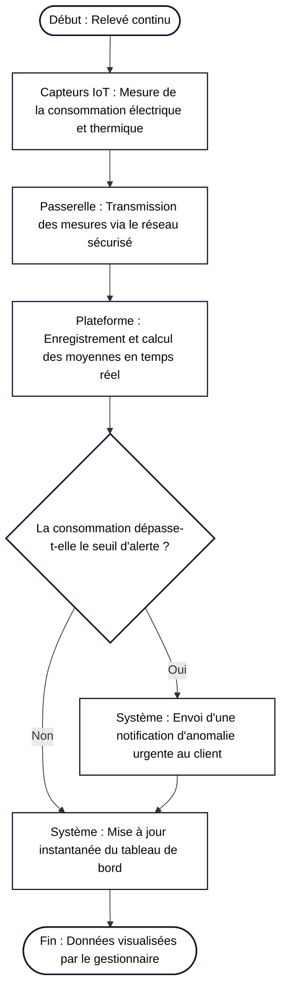
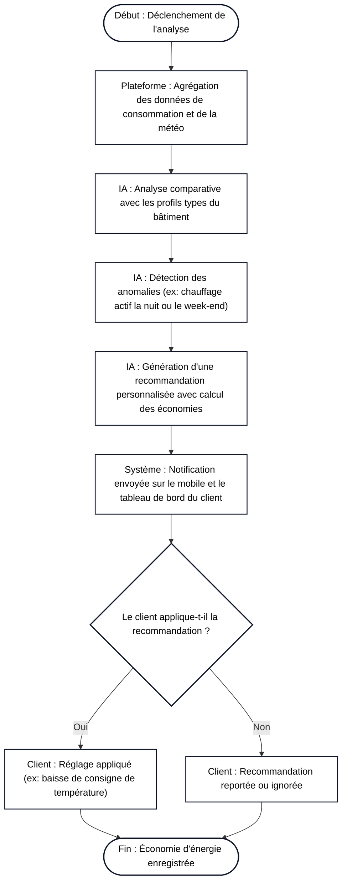
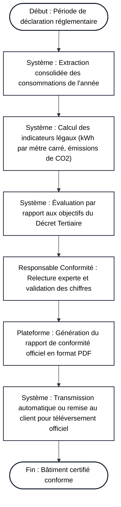

# Étude de Cas : Architecture Business pour GreenBreiZH

**Établissement :** CFA INSTA – Paris 2ème
**Niveau :** Master 1 Systèmes d'Information (Master SI)
**Matière :** Architecture des Systèmes d'Information
**Document complété :** EDC_Archi_Business (Cours 2 TP Architecture Métier)

---

## 1. Contexte

GreenBreiZH est une entreprise de services énergétiques spécialisée dans l’optimisation de la consommation d’énergie pour les grands bâtiments commerciaux et les entreprises. Face aux exigences croissantes en matière de durabilité, GreenBreiZH souhaite lancer une application innovante de gestion de l’efficacité énergétique, destinée à aider ses clients à surveiller, analyser et réduire leur consommation énergétique.

L’objectif de GreenBreiZH est de fournir une solution complète de gestion de la consommation énergétique, permettant aux utilisateurs d’obtenir des recommandations en temps réel et d’améliorer leur conformité réglementaire en matière d’énergie et d’environnement.

---

## 2. Travail à réaliser

En tant qu’équipe d’architectes business pour GreenBreiZH, vous êtes chargés de concevoir les documents et outils de l’architecture business pour orienter le développement de la nouvelle application de gestion énergétique. Votre mission consiste à produire les livrables suivants :

---

## 1) Document d’Objectifs et de Stratégie Métier

> **Description (Sujet EDC) :**
> Rédigez un document décrivant les objectifs principaux de GreenBreiZH pour cette application, les attentes en matière de satisfaction client, de conformité réglementaire, et de compétitivité.

> **Détails (Sujet EDC) :**Incluez une stratégie claire détaillant comment l’entreprise compte atteindre ces objectifs. Pensez aux éléments suivants :
>
> * Création de valeur pour les clients
> * Modèle économique (abonnement SaaS, personnalisation, etc.)
> * Stratégies de différenciation face à la concurrence

### Réponses et Développements :

#### Objectifs Principaux

* **Satisfaction client :** L'application a pour objectif de réduire la facture énergétique globale des clients de quinze à vingt-cinq pour cent dès la première année d'utilisation en identifiant clairement les gaspillages invisibles.
* **Conformité réglementaire :** La solution doit permettre aux entreprises de se conformer sans effort aux normes environnementales obligatoires, en particulier les déclarations annuelles du Décret Tertiaire et la certification ISO 50001.
* **Compétitivité et croissance :** GreenBreiZH vise à s'imposer comme la plateforme de référence de la gestion énergétique connectée pour les bâtiments d'entreprises.

#### Stratégie Métier

* **Création de valeur pour les clients :** La plateforme offre une vision claire et en direct des consommations d'électricité, de gaz et d'eau, tout en traduisant les kilowattheures économisés en gains financiers concrets et en réduction mesurable des émissions de CO2.
* **Modèle économique :** GreenBreiZH s'appuie sur un modèle d'abonnement logiciel mensuel de type SaaS facturé selon la surface du bâtiment et le nombre de compteurs connectés, complété par des prestations d'accompagnement humain pour les audits approfondis.
* **Stratégies de différenciation face à la concurrence :** Contrairement aux simples tableaux de bord passifs du marché, GreenBreiZH se démarque grâce à une intelligence artificielle capable de proposer des actions correctives personnalisées en temps réel et de générer automatiquement les rapports officiels sans travail de ressaisie.

---

## 2) Diagrammes des Processus Métier

> **Description (Sujet EDC) :**
> Réalisez les diagrammes des principaux processus métier identifiés pour l’application de GreenBreiZH.

> **Détails (Sujet EDC) :**Les processus doivent inclure :
>
> * Suivi de la consommation énergétique en temps réel
> * Analyse et génération de recommandations énergétiques
> * Rapport de conformité énergétique et réglementaire

> **Recommandations (Sujet EDC) :**
> Utilisez la notation BPMN pour représenter chaque processus et mettez en avant les interactions principales.

### Réponses et Diagrammes :

#### 2.1 Suivi de la consommation énergétique en temps réel

Ce processus modélise la capture en direct des données par les compteurs communicants, le contrôle automatique des seuils de puissance et l'affichage pour le gestionnaire du bâtiment.

#### 2.2 Analyse et génération de recommandations énergétiques

Ce processus décrit le traitement automatique des historiques par l'intelligence artificielle pour formuler des conseils concrets au client.

#### 2.3 Rapport de conformité énergétique et réglementaire

Ce processus retrace la création du bilan annuel officiel exigé par les autorités environnementales.

---

## 3) Matrice des Rôles et Responsabilités (RACI)

> **Description (Sujet EDC) :**
> Créez une matrice RACI pour répartir les rôles et responsabilités au sein de l’équipe de GreenBreiZH et des utilisateurs de l’application.

> **Détails (Sujet EDC) :**
> La matrice doit inclure les rôles suivants : Administrateur système, Utilisateur client, IA de recommandation, Responsable conformité.

### Réponses et Répartition des Rôles :

#### 1. Configuration initiale et maintenance des capteurs et de la plateforme

* L'**Administrateur système** est le Réalisateur principal qui installe, paramètre et maintient les serveurs et les connexions réseau des capteurs.
* Le **Responsable conformité** est l'Approbateur final garantissant que la collecte respecte les règles de protection des données et de traçabilité légale.
* L'**Utilisateur client** est Consulté pour définir les caractéristiques techniques du bâtiment et les accès aux compteurs.
* L'**IA de recommandation** est Informée automatiquement de l'activation des nouveaux flux de mesure.

#### 2. Surveillance des consommations et traitement des alertes en direct

* L'**Utilisateur client** est le Réalisateur qui consulte ses indicateurs, reçoit les alertes de surconsommation et applique les corrections dans ses locaux.
* L'**Administrateur système** est l'Approbateur du bon fonctionnement technique du système d'alerte et de la disponibilité du service en continu.
* L'**IA de recommandation** est Consultée pour fournir l'analyse d'écart expliquant la cause probable du dépassement de consommation.
* Le **Responsable conformité** est Informé des anomalies majeures pouvant compromettre les engagements environnementaux du bâtiment.

#### 3. Calcul et génération des conseils d'optimisation énergétique

* L'**IA de recommandation** est le Réalisateur qui traite les algorithmes d'apprentissage, détecte les gaspillages et calcule les recommandations d'économies.
* Le **Responsable conformité** est l'Approbateur qui s'assure que les actions d'optimisation préconisées restent conformes aux réglementations thermiques et au confort des occupants.
* L'**Utilisateur client** est Consulté pour ajuster ses préférences de confort et valider la faisabilité des actions proposées.
* L'**Administrateur système** est Informé de la charge de calcul machine générée par les algorithmes de l'intelligence artificielle.

#### 4. Rédaction et certification du bilan réglementaire annuel

* Le **Responsable conformité** est le Réalisateur et l'Approbateur qui supervise le calcul des ratios légaux, valide l'exactitude des déclarations et certifie le rapport officiel.
* L'**Utilisateur client** est Consulté pour fournir les justificatifs d'activité ou les éventuelles modifications de surface du bâtiment.
* L'**IA de recommandation** est Consultée pour projeter les trajectoires d'émissions de carbone des années suivantes.
* L'**Administrateur système** est Informé de la publication du rapport et de son archivage sécurisé sur la plateforme.

---

## 4) Catalogue des Services Métier

> **Description (Sujet EDC) :**
> Dressez un catalogue des services métier que l’application proposera aux clients de GreenBreiZH.

> **Détails (Sujet EDC) :**Pour chaque service, décrivez :
>
> * Nom et description du service
> * Valeur ajoutée pour le client
> * Mode d’accès (tableau de bord, notifications, etc.)

> **Exemples de services (Sujet EDC) :**
> Suivi de la consommation, recommandations d’optimisation, rapports de conformité.

### Réponses et Fiches des Services :

#### Service 1 : Suivi de la consommation énergétique en temps réel

* **Nom et description du service :** Suivi en direct des consommations énergétiques. Ce service collecte, centralise et affiche en permanence les flux d'électricité, de gaz et d'eau consommés par les équipements du bâtiment.
* **Valeur ajoutée pour le client :** Il apporte une visibilité complète sur les dépenses pour déceler immédiatement les gaspillages hors des heures d'ouverture et repérer les dérives d'équipements lourds.
* **Mode d’accès :** Les données sont accessibles en permanence sur un tableau de bord web interactif ainsi que sur une application mobile avec actualisation minute par minute.

#### Service 2 : Recommandations d'optimisation pilotées par l'Intelligence Artificielle

* **Nom et description du service :** Recommandations d'optimisation énergétique par IA. Ce service analyse les habitudes d'usage et la météo extérieure pour proposer des actions d'ajustement immédiates.
* **Valeur ajoutée pour le client :** Il permet d'obtenir des économies financières rapides sans perte de confort pour les salariés, tout en chiffrant à l'avance les euros économisés pour chaque décision prise.
* **Mode d’accès :** Les conseils sont envoyés sous forme de notifications push sur smartphone, d'alertes par e-mail et d'un encart dédié sur l'écran d'accueil du portail web.

#### Service 3 : Rapports de conformité énergétique et réglementaire

* **Nom et description du service :** Bilan et reporting de conformité réglementaire. Ce service automatise l'extraction, le calcul et l'édition des indicateurs obligatoires liés aux décrets environnementaux nationaux et européens.
* **Valeur ajoutée pour le client :** Il supprime la lourdeur des démarches administratives annuelles, évite les amendes pour non-conformité et valorise l'image écologique de l'entreprise auprès de ses partenaires.
* **Mode d’accès :** Le client télécharge directement un rapport officiel certifié en format PDF depuis son espace client et peut exporter les données brutes sous format tableur.

#### Service 4 : Gestion des seuils et alertes préventives

* **Nom et description du service :** Système d'alerte et de gestion des dépassements de puissance. Ce service surveille les limites de puissance souscrite et avertit les équipes avant tout risque de dépassement critique.
* **Valeur ajoutée pour le client :** Il évite les coupures de courant imprévues et élimine les pénalités de surconsommation facturées par les fournisseurs d'énergie.
* **Mode d’accès :** Les alertes urgentes sont diffusées instantanément par SMS, alertes vocales et e-mails aux techniciens et responsables du bâtiment.
