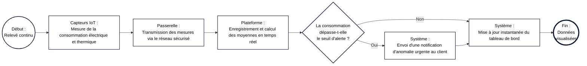
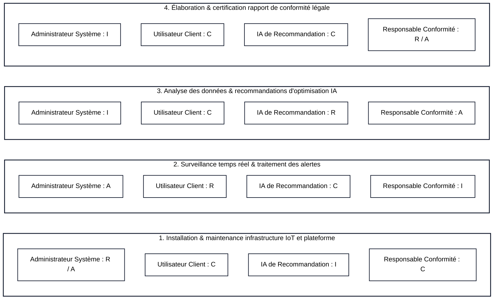

# Étude de Cas : Architecture Business pour GreenBreiZH

> **Établissement :** CFA INSTA – Paris 2ème
> **Formation :** Master 1 Architecte des Systèmes d'Information (Master SI)
> **Matière :** Architecture des Systèmes d'Information — Architecture Métier
> **Document de référence :** `EDC_Archi_Business.pdf` (Cours 2 TP)

---

## 📑 Sommaire

* [1. Contexte et Mission](#1-contexte-et-mission)
* [2. Livrable 1 : Document d’Objectifs et de Stratégie Métier](#2-livrable-1--document-dobjectifs-et-de-stratégie-métier)
* [3. Livrable 2 : Diagrammes des Processus Métier (Notation BPMN)](#3-livrable-2--diagrammes-des-processus-métier-notation-bpmn)
* [4. Livrable 3 : Matrice des Rôles et Responsabilités (RACI)](#4-livrable-3--matrice-des-rôles-et-responsabilités-raci)
* [5. Livrable 4 : Catalogue des Services Métier](#5-livrable-4--catalogue-des-services-métier)
* [6. Synthèse de Cohérence Business](#6-synthèse-de-cohérence-business)

---

## 1. Contexte et Mission

GreenBreiZH est une entreprise de services énergétiques spécialisée dans l’optimisation de la consommation d’énergie pour les grands bâtiments commerciaux et les entreprises. Face aux exigences croissantes en matière de durabilité, GreenBreiZH souhaite lancer une application innovante de gestion de l’efficacité énergétique, destinée à aider ses clients à surveiller, analyser et réduire leur consommation énergétique.

L’objectif de GreenBreiZH est de fournir une solution complète de gestion de la consommation énergétique, permettant aux utilisateurs d’obtenir des recommandations en temps réel et d’améliorer leur conformité réglementaire en matière d’énergie et d’environnement.

En tant qu’équipe d’architectes business pour GreenBreiZH, notre mission consiste à concevoir les quatre livrables directeurs destinés à cadrer le développement de cette nouvelle application.

---

## 2. Livrable 1 : Document d’Objectifs et de Stratégie Métier

> **Description (Sujet EDC) :**
> Rédigez un document décrivant les objectifs principaux de GreenBreiZH pour cette application, les attentes en matière de satisfaction client, de conformité réglementaire, et de compétitivité.
>
> **Détails (Sujet EDC) :**Incluez une stratégie claire détaillant comment l’entreprise compte atteindre ces objectifs. Pensez aux éléments suivants :
>
> * Création de valeur pour les clients
> * Modèle économique (abonnement SaaS, personnalisation, etc.)
> * Stratégies de différenciation face à la concurrence

### 2.1 Objectifs Principaux

* **Satisfaction client :** L'application vise à réduire la facture énergétique globale des entreprises clientes de quinze à vingt-cinq pour cent dès la première année, en offrant une interface claire qui met immédiatement en évidence les gaspillages invisibles et les équipements mal réglés.
* **Conformité réglementaire :** La solution garantit aux gestionnaires de bâtiments commerciaux de respecter sans effort les obligations légales environnementales en vigueur, notamment les déclarations annuelles du Décret Tertiaire (plateforme OPERAT) et les audits liés à la norme ISO 50001.
* **Compétitivité et positionnement :** GreenBreiZH ambitionne de s'imposer comme la référence sur le marché de l'efficacité énergétique B2B en associant la remontée de données IoT en temps réel à une intelligence artificielle d'aide à la décision.

### 2.2 Stratégie pour Atteindre ces Objectifs

* **Création de valeur pour les clients :** La plateforme transforme des données techniques brutes en indicateurs décisionnels concrets. Elle localise les consommations anormales durant les heures de fermeture, chiffre chaque économie d'énergie directement en euros et mesure l'empreinte carbone évitée afin de valoriser la démarche RSE du client.
* **Modèle économique :** GreenBreiZH adopte un modèle hybride basé sur un abonnement logiciel mensuel de type SaaS. Le tarif s'adapte par paliers selon la surface du bâtiment et le nombre de compteurs connectés. Cette base récurrente est complétée par des options de personnalisation payantes incluant le déploiement sur mesure de capteurs et l'accompagnement par des experts énergéticiens.
* **Stratégies de différenciation face à la concurrence :** Alors que les solutions concurrentes se limitent souvent à afficher des graphiques statiques a posteriori, GreenBreiZH se distingue par deux leviers majeurs : un moteur d'intelligence artificielle proactif qui formule des recommandations d'optimisation exploitables en temps réel, et un module automatisé qui génère les dossiers de conformité réglementaire en un clic sans ressaisie manuelle.

---

## 3. Livrable 2 : Diagrammes des Processus Métier (Notation BPMN)

> **Description (Sujet EDC) :**
> Réalisez les diagrammes des principaux processus métier identifiés pour l’application de GreenBreiZH.
>
> **Détails (Sujet EDC) :**Les processus doivent inclure :
>
> * Suivi de la consommation énergétique en temps réel
> * Analyse et génération de recommandations énergétiques
> * Rapport de conformité énergétique et réglementaire
>
> **Recommandations (Sujet EDC) :**
> Utilisez la notation BPMN pour représenter chaque processus et mettez en avant les interactions principales.

*(Note : Les schémas Mermaid ci-dessous sont synchronisés exactement avec les 4 onglets du fichier Draw.io éditable : [`PROCESSUS_BPMN_GREENBREIZH.drawio`](./PROCESSUS_BPMN_GREENBREIZH.drawio)).*

### 3.1 Processus 1 : Suivi de la consommation énergétique en temps réel

Ce processus modélise la capture des données depuis les capteurs jusqu'à la détection d'anomalie et l'affichage sur le tableau de bord client.

### 3.2 Processus 2 : Analyse et génération de recommandations énergétiques

Ce processus décrit le traitement des données par l'IA, l'envoi des conseils d'économie d'énergie et le choix d'application du client.

```mermaid
flowchart LR
    p2_start(("Début :<br>Déclenchement<br>analyse")) --> p2_task1["Plateforme :<br>Agrégation des données de consommation et météo"]
    p2_task1 --> p2_task2["IA :<br>Analyse comparative avec les profils types du bâtiment"]
    p2_task2 --> p2_task3["IA :<br>Détection des anomalies<br>(ex: chauffage nuit/week-end)"]
    p2_task3 --> p2_task4["IA :<br>Génération de recommandation personnalisée & gains"]
    p2_task4 --> p2_task5["Système :<br>Notification smartphone et tableau de bord client"]
    p2_task5 --> p2_gw{"Le client<br>applique-t-il la<br>recommandation ?"}
    p2_gw -- "Oui" --> p2_save["Client :<br>Réglage appliqué<br>(ex: baisse consigne)"]
    p2_gw -- "Non" --> p2_feed["Client :<br>Recommandation<br>reportée ou ignorée"]
    p2_save --> p2_end(("Fin :<br>Résultat<br>enregistré"))
    p2_feed --> p2_end

    classDef default fill:#ffffff,stroke:#0f172a,stroke-width:1.5px,color:#000000;
    style p2_start fill:#ffffff,stroke:#0f172a,stroke-width:2px,color:#000000
    style p2_gw fill:#ffffff,stroke:#0f172a,stroke-width:2px,color:#000000
    style p2_end fill:#ffffff,stroke:#0f172a,stroke-width:4px,color:#000000
```

### 3.3 Processus 3 : Rapport de conformité énergétique et réglementaire

Ce processus retrace la création, la validation experte et la transmission du bilan annuel légal.

```mermaid
flowchart LR
    p3_start(("Début :<br>Période de<br>déclaration")) --> p3_task1["Système :<br>Extraction consolidée des consommations de l'année"]
    p3_task1 --> p3_task2["Système :<br>Calcul des indicateurs légaux (kWh/m², émissions de CO2)"]
    p3_task2 --> p3_task3["Système :<br>Évaluation par rapport aux objectifs du Décret Tertiaire"]
    p3_task3 --> p3_task4["Responsable Conformité :<br>Relecture experte et validation des chiffres"]
    p3_task4 --> p3_task5["Plateforme :<br>Génération du rapport de conformité officiel PDF"]
    p3_task5 --> p3_task6["Système :<br>Télétransmission ou remise au client pour téléversement"]
    p3_task6 --> p3_end(("Fin :<br>Bâtiment<br>certifié conforme"))

    classDef default fill:#ffffff,stroke:#0f172a,stroke-width:1.5px,color:#000000;
    style p3_start fill:#ffffff,stroke:#0f172a,stroke-width:2px,color:#000000
    style p3_task4 fill:#ffffff,stroke:#0f172a,stroke-width:2px,color:#000000
    style p3_end fill:#ffffff,stroke:#0f172a,stroke-width:4px,color:#000000
```

---

## 4. Livrable 3 : Matrice des Rôles et Responsabilités (RACI)

> **Description (Sujet EDC) :**
> Créez une matrice RACI pour répartir les rôles et responsabilités au sein de l’équipe de GreenBreiZH et des utilisateurs de l’application.
>
> **Détails (Sujet EDC) :**
> La matrice doit inclure les rôles suivants : Administrateur système, Utilisateur client, IA de recommandation, Responsable conformité.

Pour garantir une gouvernance sans ambiguïté, chaque activité clé répartit précisément les rôles selon les quatre niveaux de responsabilité : **R (Réalisateur)** qui exécute l'action, **A (Approbateur)** qui porte la responsabilité finale, **C (Consulté)** qui apporte son expertise, et **I (Informé)** qui reçoit le résultat.

### Diagramme RACI (Vue Visuelle Globale)

### 4.1 Installation, paramétrage et maintenance de l'infrastructure IoT

* L'**Administrateur système** est **R (Réalisateur)** et **A (Approbateur)** car il déploie la plateforme cloud, configure les capteurs communicants et garantit la continuité de service technique.
* L'**Utilisateur client** est **C (Consulté)** afin de fournir les plans techniques des bâtiments et autoriser l'accès physique aux compteurs.
* Le **Responsable conformité** est **C (Consulté)** pour vérifier que le stockage des mesures respecte la sécurité et la confidentialité des données (RGPD).
* L'**IA de recommandation** est **I (Informée)** dès l'ouverture des nouveaux flux de mesure pour initialiser son apprentissage.

### 4.2 Surveillance en temps réel et traitement des alertes de surconsommation

* L'**Utilisateur client** est **R (Réalisateur)** lorsqu'il consulte son tableau de bord et déclenche les interventions sur ses équipements en cas de dérive.
* L'**Administrateur système** est **A (Approbateur)** de la fiabilité du système de détection et de l'acheminement sans délai des notifications.
* L'**IA de recommandation** est **C (Consultée)** pour qualifier la gravité du pic de consommation et fournir un premier diagnostic automatique.
* Le **Responsable conformité** est **I (Informé)** uniquement lors de dépassements critiques susceptibles d'impacter les objectifs réglementaires annuels.

### 4.3 Analyse des données et génération des recommandations d'optimisation

* L'**IA de recommandation** est **R (Réalisateur)** car elle exécute les modèles prédictifs, identifie les gaspillages et calcule les économies attendues.
* Le **Responsable conformité** est **A (Approbateur)** afin de s'assurer que les consignes proposées respectent les normes de confort thermique et la législation du travail.
* L'**Utilisateur client** est **C (Consulté)** lors de la configuration de ses horaires d'occupation et de ses préférences de température.
* L'**Administrateur système** est **I (Informé)** de l'utilisation des ressources de calcul générée par l'entraînement et l'exécution des modèles.

### 4.4 Élaboration et certification du rapport de conformité réglementaire

* Le **Responsable conformité** est **R (Réalisateur)** et **A (Approbateur)** car il audite les indicateurs légaux, valide les écarts par rapport au Décret Tertiaire et certifie le bilan annuel.
* L'**Utilisateur client** est **C (Consulté)** pour confirmer les éventuelles évolutions de surface ou d'activité de ses locaux durant l'année écoulée.
* L'**IA de recommandation** est **C (Consultée)** pour projeter les trajectoires prévisionnelles de réduction carbone sur les cinq prochaines années.
* L'**Administrateur système** est **I (Informé)** de la génération du document officiel afin d'en assurer l'archivage sécurisé à valeur probante.

---

## 5. Livrable 4 : Catalogue des Services Métier

> **Description (Sujet EDC) :**
> Dressez un catalogue des services métier que l’application proposera aux clients de GreenBreiZH.
>
> **Détails (Sujet EDC) :**Pour chaque service, décrivez :
>
> * Nom et description du service
> * Valeur ajoutée pour le client
> * Mode d’accès (tableau de bord, notifications, etc.)
>
> **Exemples de services (Sujet EDC) :**
> Suivi de la consommation, recommandations d’optimisation, rapports de conformité.

### 5.1 Service 1 : Suivi de la consommation énergétique en temps réel

* **Nom et description du service :** *Monitoring Énergétique Live*. Ce service assure la collecte continue, l'agrégation et la visualisation instantanée des consommations d'électricité, de gaz, de chauffage et d'eau de chaque bâtiment raccordé.
* **Valeur ajoutée pour le client :** Il supprime les zones d'ombre dans la gestion des dépenses énergétiques, permet de détecter immédiatement un équipement resté allumé inutilement la nuit et facilite la comparaison entre plusieurs sites commerciaux.
* **Mode d’accès :** Le service est accessible en permanence via un tableau de bord web interactif sur ordinateur et depuis une application mobile dédiée avec rafraîchissement des courbes toutes les minutes.

### 5.2 Service 2 : Recommandations d’optimisation énergétique par IA

* **Nom et description du service :** *Conseiller IA d'Efficacité Énergétique*. Ce service croise les historiques d'utilisation du bâtiment, les prévisions météorologiques et les tarifs horaires d'énergie pour formuler des actions concrètes d'ajustement.
* **Valeur ajoutée pour le client :** Il permet de réaliser des économies financières immédiates et mesurables sans dégrader le confort des occupants, tout en affichant à l'avance le gain estimé en euros pour chaque action suggérée.
* **Mode d’accès :** Les recommandations sont poussées directement par notifications mobiles, résumées chaque semaine par courrier électronique et centralisées dans un fil d'actions prioritaires sur le portail web.

### 5.3 Service 3 : Rapports de conformité énergétique et réglementaire

* **Nom et description du service :** *Conformité Réglementaire Automatisée (Décret Tertiaire & ISO 50001)*. Ce service extrait les données certifiées de l'année écoulée, calcule automatiquement les ratios réglementaires obligatoires (kWh par mètre carré et tonnes de CO2) et met en forme les déclarations officielles.
* **Valeur ajoutée pour le client :** Il élimine des dizaines d'heures de compilation manuelle sur tableurs, protège l'entreprise contre les sanctions financières liées au non-respect de la loi et fournit des preuves vérifiables pour la communication environnementale (RSE).
* **Mode d’accès :** Le client génère et télécharge ses rapports certifiés au format PDF directement depuis son espace de gouvernance sur le portail web, avec option d'export structuré pour les organismes publics.

### 5.4 Service 4 : Prévention des dépassements et gestion des alertes critiques

* **Nom et description du service :** *Sentinelle de Puissance & Alerting*. Ce service surveille en permanence les appels de puissance électrique par rapport aux plafonds contractuels souscrits auprès des fournisseurs et repère les dérives matérielles soudaines.
* **Valeur ajoutée pour le client :** Il protège les installations contre les coupures électriques imprévues et évite les lourdes pénalités de dépassement de puissance facturées par les distributeurs d'énergie.
* **Mode d’accès :** Les alertes critiques sont transmises sans délai par SMS, notification mobile prioritaire et e-mail ciblé aux responsables techniques et équipes de maintenance du bâtiment.

---

## 6. Synthèse de Cohérence Business

L'architecture métier conçue pour GreenBreiZH aligne l'ensemble des choix stratégiques, organisationnels et fonctionnels autour d'un objectif unique : transformer la donnée énergétique brute en performance économique et environnementale durable.

En combinant un modèle SaaS accessible, des processus automatisés centrés sur l'interaction fluide entre l'IA et le gestionnaire, une gouvernance RACI rigoureuse et un catalogue de services à forte valeur ajoutée immédiate, GreenBreiZH dispose d'une base solide pour orienter le développement technique de sa plateforme et conquérir durablement le marché des bâtiments tertiaires.
