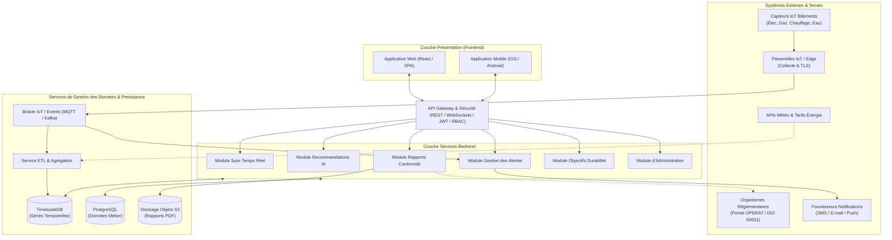
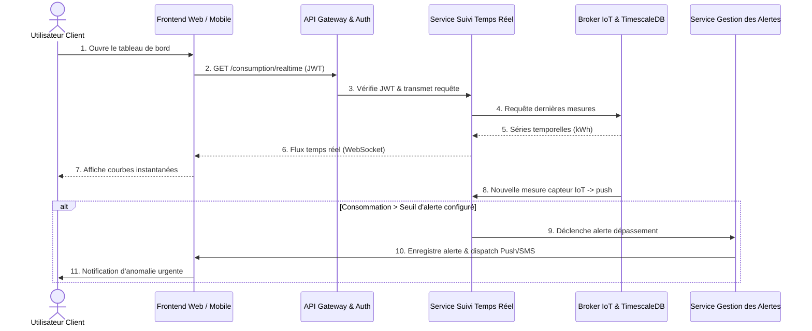
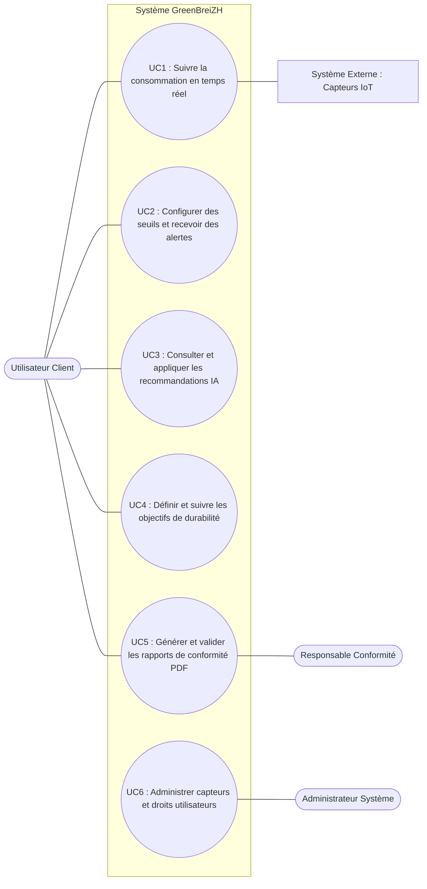

# Étude de Cas : Architecture Applicative pour GreenBreiZH

> **Établissement :** CFA INSTA – Paris 2ème
> **Formation :** Master 1 Architecte des Systèmes d'Information (Master SI)
> **Matière :** Architecture des Systèmes d'Information — Architecture Applicative
> **Document de référence :** `EDC_Archi_Applicative.pdf` (Cours 3 TP)

---

## Sommaire

* [1. Contexte et Mission](#1-contexte-et-mission)
* [2. Livrable 1 : Schéma d’Architecture Applicative](#2-livrable-1--schéma-darchitecture-applicative)
* [3. Livrable 2 : Catalogue des Modules et Services Applicatifs](#3-livrable-2--catalogue-des-modules-et-services-applicatifs)
* [4. Livrable 3 : Diagrammes de Séquence et Cas d’Utilisation](#4-livrable-3--diagrammes-de-séquence-et-cas-dutilisation)
* [5. Livrable 4 : Spécifications des Interfaces (API Documentation)](#5-livrable-4--spécifications-des-interfaces-api-documentation)
* [6. Synthèse de Cohérence Applicative](#6-synthèse-de-cohérence-applicative)

---

## 1. Contexte et Mission

GreenBreiZH est une société de services énergétiques qui aide ses clients (grands immeubles commerciaux et entreprises) à surveiller, analyser et optimiser leur consommation d’énergie. Dans la continuité du cadrage métier (Cours 2), GreenBreiZH lance la conception technique et logicielle de sa plateforme SaaS de gestion énergétique.

L’application de GreenBreiZH doit permettre aux utilisateurs :

* De suivre la consommation d’énergie en temps réel.
* De recevoir des recommandations personnalisées pour réduire leur consommation et leur empreinte carbone.
* D’obtenir des rapports de conformité énergétique.
* De recevoir des alertes en cas de dépassement de seuils de consommation.

En tant qu’architectes applicatifs, notre mission consiste à produire les quatre livrables d’architecture applicative structurant les composants logiciels, les flux de données, les interactions et les API de la plateforme.

---

## 2. Livrable 1 : Schéma d’Architecture Applicative

> **Consigne (Sujet EDC) :**
> Développez un schéma illustrant l'architecture applicative de l’application GreenBreiZH. Votre schéma doit présenter les principaux composants de l’application, incluant les modules frontend, backend, services de gestion de données, et la base de données. Pensez à inclure des interconnexions avec des systèmes externes (capteurs IoT).

L'architecture retenue repose sur une approche **modulaire en couches et orientée événements** afin de concilier la collecte IoT haute fréquence en temps réel, les traitements analytiques IA et la génération fiable des dossiers réglementaires.

*(Note : Les schémas ci-dessous sont synchronisés avec les 3 onglets du fichier Draw.io éditable : [`ARCHI_APPLICATIVE_GREENBREIZH.drawio`](./ARCHI_APPLICATIVE_GREENBREIZH.drawio)).*



### 2.1 Justification des choix d'architecture

* **Séparation des flux temps réel et des données métier :** Les mesures continues des capteurs IoT transitent par un broker de messages (`MQTT / Kafka`) vers une base de séries temporelles (`TimescaleDB`) optimisée pour l'horodatage, tandis que les référentiels (clients, bâtiments, seuils, droits) résident dans `PostgreSQL`.
* **Point d'entrée unique sécurisé :** L'`API Gateway` centralise l'authentification (`JWT / OAuth2`), le contrôle d'accès par rôle (`RBAC` : Utilisateur client, Responsable conformité, Administrateur système) et la protection contre la surcharge (`Rate Limiting`).
* **Découplage des services externes :** Les APIs météo/tarifaires, le portail réglementaire `OPERAT` et les passerelles d'envoi (`SMS / E-mail / Push`) sont isolés derrière des connecteurs dédiés.

---

## 3. Livrable 2 : Catalogue des Modules et Services Applicatifs

> **Consigne (Sujet EDC) :**
> Fournissez un catalogue répertoriant les différents modules applicatifs et services backend de l’application. Pour chaque module/service, décrivez ses fonctionnalités et son rôle dans le système.

### 3.1 Vue synthétique du catalogue

| # | Module / Service | Couche | Rôle principal dans le système |
|---|---|---|---|
| **1** | **Interfaces Frontend (Web & Mobile)** | Présentation | Offrir les tableaux de bord interactifs, le suivi nomade, la configuration et la consultation des rapports. |
| **2** | **API Gateway & Sécurité** | Exposition | Unifier l'accès aux microservices, authentifier les utilisateurs (`JWT`) et appliquer les droits `RBAC`. |
| **3** | **Module de Suivi en Temps Réel** | Backend | Collecter, diffuser en direct (`WebSockets`) et exposer les consommations issues des capteurs IoT. |
| **4** | **Module de Recommandations d’Optimisation (IA)** | Backend | Détecter les dérives énergétiques et produire des recommandations chiffrées par algorithmes d'IA. |
| **5** | **Module de Rapports de Conformité** | Backend | Calculer les indicateurs légaux (`kWh/m²`, `CO2`), comparer aux normes et générer les rapports PDF. |
| **6** | **Module de Gestion des Alertes** | Backend | Évaluer les règles de seuils et déclencher les notifications multicanales en cas de dépassement. |
| **7** | **Module de Gestion des Objectifs de Durabilité** | Backend | Suivre les cibles de réduction énergétique et carbone fixées par le client sur la durée. |
| **8** | **Module d’Administration** | Backend | Gérer le cycle de vie des capteurs IoT, les bâtiments raccordés, les comptes et les habilitations. |
| **9** | **Services de Gestion des Données & Persistance** | Données | Assurer l'ingestion asynchrone, l'ETL/agrégation, le stockage time-series/relationnel et l'archivage PDF. |

### 3.2 Description détaillée des modules et services

#### 1. Interfaces Frontend (Application Web & Application Mobile)
* **Rôle dans le système :** Point de contact direct entre les utilisateurs finaux (gestionnaires de bâtiments, responsables conformité, administrateurs) et les services métier de GreenBreiZH.
* **Fonctionnalités :**
  * Affichage temps réel des courbes de consommation par bâtiment, zone et type d'énergie (électricité, gaz, chauffage, eau).
  * Interface de paramétrage des seuils d'alerte et des objectifs de durabilité.
  * Fil interactif des recommandations IA avec simulation d'économies (`€`, `kWh`, `kgCO2`) et suivi d'application.
  * Téléchargement des rapports de conformité PDF et console d'administration (web).

#### 2. API Gateway & Service d'Authentification / Autorisation
* **Rôle dans le système :** Ce module fait le lien entre les différents services backend et les interfaces utilisateur (applications web et mobile). Il protège le cœur applicatif contre les accès non autorisés.
* **Fonctionnalités :**
  * Routage des appels REST et des connexions WebSockets vers le microservice cible.
  * Authentification des utilisateurs via jetons `JWT / OAuth2` et vérification fine des permissions (`RBAC`).
  * Limitation de débit (`Rate Limiting`), journalisation d'audit des requêtes et agrégation de réponses.

#### 3. Module de Suivi en Temps Réel
* **Rôle dans le système :** Fournir une visibilité instantanée et continue sur la consommation énergétique de chaque bâtiment raccordé.
* **Fonctionnalités :**
  * Consommation des flux de mesures normalisées depuis le broker IoT.
  * Diffusion en direct vers les tableaux de bord via WebSockets / Server-Sent Events (`SSE`).
  * Calcul glissant des puissances appelées et exposition de l'historique récent pour les graphiques interactifs.
  * Gestion des configurations de seuils associés aux compteurs.

#### 4. Module de Recommandations d’Optimisation (Moteur IA)
* **Rôle dans le système :** Transformer les données brutes en décisions d'économie d'énergie personnalisées et actionnables.
* **Fonctionnalités :**
  * Croisement des historiques de consommation, des profils d'occupation, de la météo et des grilles tarifaires.
  * Détection automatique des anomalies par apprentissage automatique (talon nocturne élevé, chauffage actif le week-end, dérive d'équipement).
  * Génération de recommandations priorisées accompagnées d'une estimation des gains financiers (`€`) et carbone (`kgCO2`).
  * Suivi du retour utilisateur (`appliquée`, `reportée`, `ignorée`) pour affiner les modèles prédictifs.

#### 5. Module de Rapports de Conformité
* **Rôle dans le système :** Automatiser la mise en conformité réglementaire (Décret Tertiaire / `OPERAT`, norme `ISO 50001`) et fiabiliser le reporting RSE.
* **Fonctionnalités :**
  * Extraction consolidée des consommations annuelles validées et ajustement climatique.
  * Calcul des indicateurs réglementaires (`kWh/m²`, émissions de `CO2`, écart par rapport aux objectifs légaux).
  * Workflow de relecture et de certification par le Responsable Conformité.
  * Génération de rapports officiels au format PDF téléchargeables et exports structurés compatibles `OPERAT`.

#### 6. Module de Gestion des Alertes
* **Rôle dans le système :** Prévenir les surconsommations critiques et les dépassements de puissance souscrite avant qu'ils n'entraînent des pénalités ou des pannes.
* **Fonctionnalités :**
  * Évaluation continue des seuils définis par les utilisateurs (seuil instantané en `kW`, cumul journalier en `kWh`, dérive nocturne).
  * Déduplication et priorisation des incidents (`INFO`, `WARNING`, `CRITICAL`).
  * Orchestration des notifications vers les fournisseurs externes (Push mobile, SMS, E-mail) et historisation des acquittements.

#### 7. Module de Gestion des Objectifs de Durabilité
* **Rôle dans le système :** Permettre aux entreprises clientes de piloter leur stratégie environnementale pluriannuelle et de mesurer le retour sur investissement de leurs actions.
* **Fonctionnalités :**
  * Définition d'objectifs chiffrés par site ou portefeuille de bâtiments (% de réduction `kWh`, plafond d'émissions `CO2`, échéance).
  * Calcul continu de la progression réelle par rapport à la trajectoire cible.
  * Alertes de dérive budgétaire ou carbone à mi-période.

#### 8. Module d’Administration
* **Rôle dans le système :** Garantir la gouvernance technique, la fiabilité de la collecte IoT et la sécurité des accès sur la plateforme.
* **Fonctionnalités :**
  * Enrôlement, calibration et supervision de l'état de santé des passerelles et capteurs IoT.
  * Gestion des organisations clientes, des bâtiments, des surfaces (`m²`) et des zones techniques.
  * Administration des comptes utilisateurs, des rôles et des droits d'accès (`RBAC`).

#### 9. Services de Gestion des Données & Persistance
* **Rôle dans le système :** Assurer la fiabilité, la performance et la pérennité de l'ensemble des données collectées et produites.
* **Composants :**
  * **Broker IoT / Événements (`MQTT / Kafka`) :** Ingestion sécurisée et tampon haute disponibilité des trames capteurs.
  * **Service ETL & Agrégation :** Nettoyage, déduplication, enrichissement météo/tarifaire et pré-calcul des agrégats horaires/journaliers.
  * **Base de Séries Temporelles (`TimescaleDB`) :** Stockage compressé et requêtage rapide des mesures horodatées.
  * **Base Relationnelle (`PostgreSQL`) :** Persistance transactionnelle des comptes, bâtiments, capteurs, seuils, objectifs et métadonnées de rapports.
  * **Stockage Objets (`S3 / Blob`) :** Conservation sécurisée et horodatée des rapports PDF certifiés.

---

## 4. Livrable 3 : Diagrammes de Séquence et Cas d’Utilisation

> **Consigne (Sujet EDC) :**
> * Créez un diagramme de séquence illustrant une interaction clé entre un utilisateur et l’application.
> * Identifiez et documentez au moins deux cas d’utilisation pour l’application GreenBreiZH, en incluant les acteurs impliqués et l’objectif de chaque cas d’utilisation.

### 4.1 Diagramme de Séquence : Suivi en Temps Réel et Alerte de Dépassement

Ce scénario illustre l'interaction complète depuis l'ouverture du tableau de bord par l'utilisateur client jusqu'au déclenchement automatique d'une alerte lorsqu'un capteur IoT remonte un dépassement de seuil.



### 4.2 Diagramme de Cas d’Utilisation



### 4.3 Documentation détaillée des Cas d’Utilisation

#### Cas d'Utilisation 1 (UC1) : Suivre la consommation énergétique en temps réel et configurer des seuils d'alerte
* **Acteurs impliqués :** Utilisateur Client (acteur principal), Capteurs IoT (acteur système secondaire).
* **Objectif :** Permettre au gestionnaire de bâtiment de visualiser en direct l'évolution de la consommation (électricité, gaz, chauffage) par zone et de paramétrer des seuils critiques pour prévenir tout dépassement.
* **Préconditions :** L'utilisateur est authentifié ; les capteurs du bâtiment sont enregistrés et actifs.
* **Scénario nominal :**
  1. L'Utilisateur Client sélectionne un bâtiment sur son tableau de bord.
  2. Le système récupère les dernières séries temporelles et ouvre un flux de mise à jour en temps réel.
  3. L'utilisateur consulte la puissance instantanée et configure un seuil maximal (ex. : `450 kW`).
  4. Lorsque les capteurs remontent une valeur supérieure au seuil, le module d'alertes envoie immédiatement une notification multicanale.

#### Cas d'Utilisation 2 (UC3) : Consulter et appliquer une recommandation d'optimisation énergétique IA
* **Acteurs impliqués :** Utilisateur Client (acteur principal), Module de Recommandations IA (acteur interne).
* **Objectif :** Aider le client à réduire sa facture énergétique et son empreinte carbone grâce à des actions concrètes, chiffrées et adaptées au profil d'occupation du bâtiment.
* **Préconditions :** Un historique suffisant de mesures IoT et de données météo est disponible pour le bâtiment.
* **Scénario nominal :**
  1. Le moteur IA détecte une anomalie (ex. : maintien du chauffage en période d'inoccupation nocturne) et calcule le gain potentiel en euros et en `kgCO2`.
  2. L'Utilisateur Client reçoit une notification et ouvre la fiche de recommandation sur le portail web ou mobile.
  3. L'utilisateur valide l'action sur son équipement (ou l'ajuste) et marque la recommandation comme appliquée afin de suivre les économies réelles générées.

#### Cas d'Utilisation 3 (UC5) : Générer, valider et télécharger un rapport de conformité réglementaire (PDF)
* **Acteurs impliqués :** Utilisateur Client, Responsable Conformité (acteur principal de validation), Organismes réglementaires `OPERAT` (externe).
* **Objectif :** Produire un bilan annuel officiel et certifié conforme aux exigences du Décret Tertiaire et de la norme `ISO 50001` sans ressaisie manuelle.
* **Préconditions :** Les données annuelles du bâtiment et sa surface (`m²`) sont consolidées.
* **Scénario nominal :**
  1. L'Utilisateur Client ou le Responsable Conformité déclenche la génération du rapport pour une année et un référentiel donnés (`DECRET_TERTIAIRE` ou `ISO_50001`).
  2. Le système calcule les ratios réglementaires (`kWh/m²`, tonnes de `CO2`) et produit un projet de rapport.
  3. Le Responsable Conformité relit et certifie les indicateurs.
  4. Le système génère le document PDF officiel archivé dans le stockage sécurisé et fournit le lien de téléchargement au client.

---

## 5. Livrable 4 : Spécifications des Interfaces (API Documentation)

> **Consigne (Sujet EDC) :**
> Documentez les spécifications de trois API principales pour l’application GreenBreiZH. Pour chaque API, précisez :
> * Le nom de l’endpoint.
> * La description de l’API et sa fonction.
> * Les paramètres nécessaires et les types de requêtes supportées (GET, POST, etc.).
> * Un exemple de réponse JSON.

Toutes les API transitent via l'`API Gateway` sous le préfixe `/api/v1`, requièrent un en-tête d'authentification `Authorization: Bearer <jwt_token>` et échangent des données au format `application/json`.

---

### 5.1 API 1 : Suivi de la consommation énergétique en temps réel

* **Nom de l’endpoint :** `GET /api/v1/buildings/{buildingId}/consumption/realtime`
* **Description et fonction :** Récupère les mesures énergétiques en temps réel (ou sur une fenêtre temporelle récente) d'un bâtiment donné, ventilées par type d'énergie et comparées aux seuils d'alerte configurés.
* **Type de requête supportée :** `GET`
* **Paramètres nécessaires :**

| Emplacement | Nom | Type | Obligatoire | Description |
|---|---|---|---|---|
| **Path** | `buildingId` | `string (UUID)` | Oui | Identifiant unique du bâtiment suivi. |
| **Header** | `Authorization` | `string` | Oui | Jeton JWT Bearer de l'utilisateur authentifié. |
| **Query** | `energyType` | `string` | Non | Filtre par énergie (`ALL`, `ELECTRICITY`, `GAS`, `HEATING`, `WATER`). Défaut : `ALL`. |
| **Query** | `granularity` | `string` | Non | Pas d'agrégation (`1m`, `15m`, `1h`). Défaut : `1m`. |
| **Query** | `from` / `to` | `string (ISO-8601)` | Non | Fenêtre temporelle souhaitée (par défaut les 60 dernières minutes). |

* **Exemple de réponse JSON (`200 OK`) :**

```json
{
  "buildingId": "bld_8f42c1a0",
  "buildingName": "Tour Armor Commerce - Rennes",
  "timestamp": "2026-11-12T11:25:00Z",
  "granularity": "1m",
  "status": "WARNING",
  "summary": {
    "currentPowerKw": 468.4,
    "configuredThresholdKw": 450.0,
    "thresholdExceeded": true,
    "estimatedHourlyCostEur": 89.20
  },
  "series": [
    {
      "energyType": "ELECTRICITY",
      "unit": "kW",
      "value": 342.1,
      "sensorCount": 18
    },
    {
      "energyType": "HEATING",
      "unit": "kW",
      "value": 126.3,
      "sensorCount": 9
    }
  ]
}
```

---

### 5.2 API 2 : Consultation et gestion des recommandations d'optimisation IA

* **Nom de l’endpoint :** `GET /api/v1/buildings/{buildingId}/recommendations`
* **Description et fonction :** Retourne la liste priorisée des recommandations générées par le moteur d'intelligence artificielle pour réduire les gaspillages énergétiques d'un bâtiment, avec les estimations d'économies financières (`€`), énergétiques (`kWh`) et carbone (`kgCO2`). *(Complétée par `PATCH /api/v1/recommendations/{id}` pour marquer une recommandation comme appliquée ou reportée).*
* **Types de requêtes supportées :** `GET` *(et `PATCH` pour la mise à jour du statut)*
* **Paramètres nécessaires :**

| Emplacement | Nom | Type | Obligatoire | Description |
|---|---|---|---|---|
| **Path** | `buildingId` | `string (UUID)` | Oui | Identifiant unique du bâtiment analysé. |
| **Header** | `Authorization` | `string` | Oui | Jeton JWT Bearer de l'utilisateur authentifié. |
| **Query** | `status` | `string` | Non | Filtre par statut (`PENDING`, `APPLIED`, `DEFERRED`, `IGNORED`). |
| **Query** | `priority` | `string` | Non | Niveau de priorité (`HIGH`, `MEDIUM`, `LOW`). |
| **Query** | `limit` | `integer` | Non | Nombre maximal de recommandations retournées (défaut : `10`). |

* **Exemple de réponse JSON (`200 OK`) :**

```json
{
  "buildingId": "bld_8f42c1a0",
  "generatedAt": "2026-11-12T11:00:00Z",
  "totalCount": 2,
  "recommendations": [
    {
      "recommendationId": "rec_2026_0941",
      "title": "Réduire la consigne de chauffage hors horaires d'ouverture",
      "category": "HVAC",
      "priority": "HIGH",
      "status": "PENDING",
      "detectedAnomaly": "Consommation thermique élevée détectée entre 21h00 et 06h00 (aile B).",
      "suggestedAction": "Abaisser la consigne de 21°C à 16°C de 20h00 à 06h30 en semaine et le week-end.",
      "estimatedSavings": {
        "energyKwhPerMonth": 4250,
        "costEurPerMonth": 765.00,
        "co2KgPerMonth": 935.0
      },
      "confidenceScore": 0.94
    },
    {
      "recommendationId": "rec_2026_0942",
      "title": "Décaler le préchauffage matinal avant les heures pleines",
      "category": "TARIFF_OPTIMIZATION",
      "priority": "MEDIUM",
      "status": "PENDING",
      "detectedAnomaly": "Pic de puissance appelé à 08h00 en tarif heure pleine.",
      "suggestedAction": "Démarrer le préchauffage à 05h30 en tarif heure creuse.",
      "estimatedSavings": {
        "energyKwhPerMonth": 610,
        "costEurPerMonth": 290.50,
        "co2KgPerMonth": 48.0
      },
      "confidenceScore": 0.89
    }
  ]
}
```

---

### 5.3 API 3 : Génération d'un rapport de conformité énergétique et réglementaire

* **Nom de l’endpoint :** `POST /api/v1/buildings/{buildingId}/compliance-reports`
* **Description et fonction :** Déclenche le calcul des indicateurs réglementaires annuels (`kWh/m²`, émissions de `CO2`, conformité Décret Tertiaire / `ISO 50001`), lance la génération du rapport officiel PDF archivé et retourne les métadonnées ainsi que le lien de téléchargement sécurisé.
* **Types de requêtes supportées :** `POST` *(création/génération)* et `GET` *(consultation d'un rapport existant)*
* **Paramètres nécessaires :**

| Emplacement | Nom | Type | Obligatoire | Description |
|---|---|---|---|---|
| **Path** | `buildingId` | `string (UUID)` | Oui | Identifiant unique du bâtiment concerné. |
| **Header** | `Authorization` | `string` | Oui | Jeton JWT Bearer (rôle `CLIENT` ou `COMPLIANCE_OFFICER`). |
| **Body (JSON)** | `year` | `integer` | Oui | Année civile du bilan réglementaire (ex. : `2025`). |
| **Body (JSON)** | `standard` | `string` | Oui | Référentiel ciblé (`DECRET_TERTIAIRE` ou `ISO_50001`). |
| **Body (JSON)** | `format` | `string` | Non | Format de sortie souhaité (`PDF`, `CSV`, `OPERAT_XML`). Défaut : `PDF`. |
| **Body (JSON)** | `includeForecast` | `boolean` | Non | Inclure la projection IA à 5 ans (défaut : `true`). |

* **Exemple de requête JSON (`POST`) :**

```json
{
  "year": 2025,
  "standard": "DECRET_TERTIAIRE",
  "format": "PDF",
  "includeForecast": true
}
```

* **Exemple de réponse JSON (`201 Created`) :**

```json
{
  "reportId": "rep_dt_2025_8f42",
  "buildingId": "bld_8f42c1a0",
  "year": 2025,
  "standard": "DECRET_TERTIAIRE",
  "status": "VALIDATED",
  "metrics": {
    "surfaceSqm": 12500,
    "totalConsumptionKwh": 1687500,
    "intensityKwhPerSqm": 135.0,
    "targetKwhPerSqm": 142.0,
    "co2EmissionsTons": 198.4,
    "complianceReached": true
  },
  "validatedBy": "responsable.conformite@greenbreizh.fr",
  "generatedAt": "2026-11-12T11:28:12Z",
  "downloadUrl": "https://api.greenbreizh.fr/api/v1/reports/rep_dt_2025_8f42/download?format=pdf"
}
```

---

## 6. Synthèse de Cohérence Applicative

L'architecture applicative conçue pour GreenBreiZH assure la traduction technique directe des processus et services métier définis en phase business :

* Le **suivi temps réel** et la **prévention des dépassements** s'appuient sur une chaîne réactive `Capteurs IoT -> Broker MQTT/Kafka -> TimescaleDB -> Service Temps Réel / Alertes` sans latence de calcul analytique.
* Le **conseiller IA d'efficacité énergétique** exploite des historiques enrichis (météo, tarifs) sans perturber la collecte opérationnelle.
* La **conformité réglementaire automatisée** garantit la traçabilité, la certification par le Responsable Conformité et l'archivage probant des bilans PDF.
* Enfin, l'`API Gateway` et le modèle `RBAC` garantissent la séparation stricte des responsabilités (Client, Responsable Conformité, Administrateur Système) définie dans la matrice RACI.
