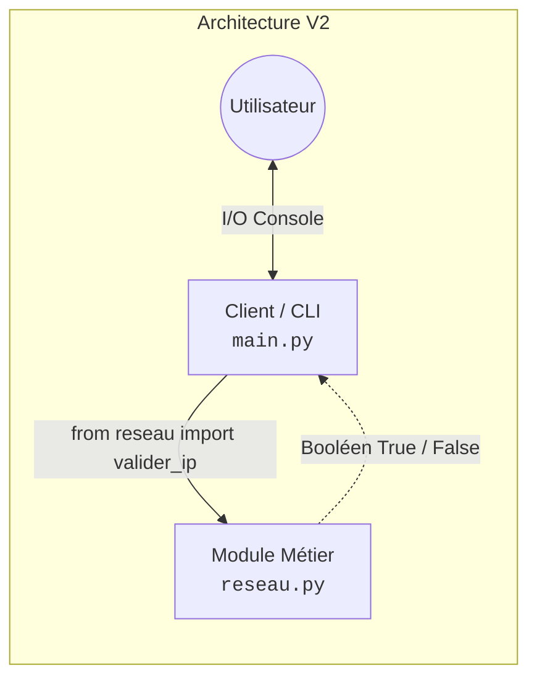
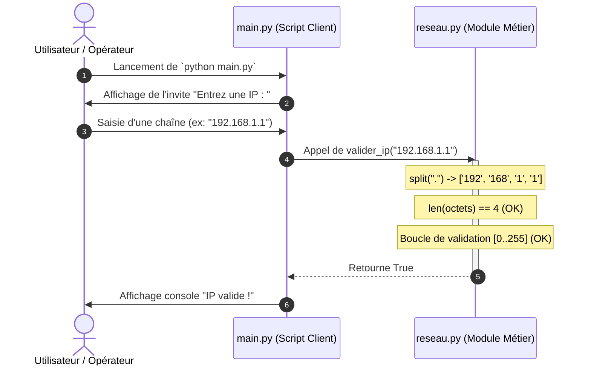

# Documentation Technique — TP0 V2 : Architecture Modulaire & Validation IPv4

**Formation :** Master 1 — Architecte des Systèmes d'Information (CFA-INSTA)  
**Matière :** Programmation Python  
**Module :** `TP0 / TP0 V2`  
**Auteur :** Promotion M1 SI  
**Statut :** Livré & Conforme  

---

## 📑 Sommaire Interactif

1. [Introduction & Contexte](#1-introduction--contexte)
2. [Principes d'Architecture : Du Monolithe au Modulaire](#2-principes-darchitecture--du-monolithe-au-modulaire)
3. [Arborescence des Composants](#3-arborescence-des-composants)
4. [Analyse Détaillée Ligne par Ligne](#4-analyse-détaillée-ligne-par-ligne)
   * [4.1 Le Module Métier : reseau.py](#41-le-module-métier--reseaupy)
   * [4.2 Le Script Exécutable : main.py](#42-le-script-exécutable--mainpy)
5. [Cinématique d'Exécution (Diagramme de Séquence)](#5-cinématique-dexécution-diagramme-de-séquence)
6. [Matrice de Qualification & Cas de Test](#6-matrice-de-qualification--cas-de-test)
7. [Guide de Déploiement & Commandes](#7-guide-de-déploiement--commandes)
8. [Perspectives d'Évolution & Robustesse](#8-perspectives-dévolution--robustesse)

---

## 1. Introduction & Contexte

Le projet **TP0 V2** a pour objectif la mise en œuvre d'un algorithme de validation syntaxique d'adresses **IPv4**. 

Au-delà de la logique algorithmique élémentaire (découpage en 4 octets compris chacun dans l'intervalle $[0, 255]$), cet atelier illustre un principe fondamental de l'ingénierie logicielle : **la séparation stricte entre la logique métier pure et l'interface utilisateur**.

---

## 2. Principes d'Architecture : Du Monolithe au Modulaire

Contrairement à la première approche (V1 / script monolithique où la saisie clavier, l'algorithme de contrôle et l'affichage étaient fusionnés dans un unique fichier), la version **V2** applique le principe de **Séparation des Responsabilités** (*Separation of Concerns - SoC*).



### Avantages de ce découpage :
* **Réutilisabilité (Reusability) :** La fonction `valider_ip` peut être importée par n'importe quel autre composant applicatif (API FastAPI, service batch, CLI) sans modification.
* **Testabilité unitaire :** Le module métier `reseau.py` peut être validé par des assertions automatisées sans simuler de saisie au clavier (`input()`).
* **Maintenance simplifiée :** Toute évolution des règles de conformité réseau est isolée dans un unique fichier.

---

## 3. Arborescence des Composants

```text
Matière/Matiere Python/TP/TP0/TP0 V2/
├── README.md       # Présente documentation technique d'architecture
├── reseau.py       # Module métier autonome (logique de validation réseau)
└── main.py         # Script exécutable (interface utilisateur CLI)
```

---

## 4. Analyse Détaillée Ligne par Ligne

### 4.1 Le Module Métier : `reseau.py`

Ce fichier constitue la bibliothèque logicielle. Il ne réalise aucune entrée/sortie standard.

```python
def valider_ip(ip):
    octets = ip.split(".")
    if len(octets) != 4:
        return False
    for o in octets:
        if int(o) < 0 or int(o) > 255:
            return False
    return True
```

| N° Ligne | Instruction | Rôle & Justification Technique |
| :---: | :--- | :--- |
| **L1** | `def valider_ip(ip):` | Définition de la fonction avec signature explicite acceptant en paramètre l'adresse brute sous forme de chaîne de caractères (`str`). |
| **L2** | `octets = ip.split(".")` | Découpage de la chaîne via le délimiteur point `.` en une liste Python. Exemple : `"192.168.1.1"` $\rightarrow$ `['192', '168', '1', '1']`. |
| **L3** | `if len(octets) != 4:` | Contrôle de cardinalité. En IPv4, une adresse valide comprend strictement 4 octets. |
| **L4** | `    return False` | Sortie précoce (*Early Return*) invalidant immédiatement l'adresse si le nombre d'octets est différent de 4. |
| **L5** | `for o in octets:` | Parcours séquentiel de chaque segment de la liste via une boucle d'itération bornée. |
| **L6** | `    if int(o) < 0 or int(o) > 255:` | Cast typé de la chaîne en entier (`int`) et vérification de conformité avec la plage d'adressage 8 bits non signée ($[0, 255]$). |
| **L7** | `        return False` | Rejet immédiat dès qu'un octet se situe hors des limites autorisées. |
| **L8** | `return True` | Validation finale : atteinte uniquement si l'intégralité des 4 octets a validé les contraintes. |

---

### 4.2 Le Script Exécutable : `main.py`

Ce fichier sert de point d'entrée pour l'opérateur humain.

```python
from reseau import valider_ip

ip = input("Entrez une IP : ")
if valider_ip(ip):
    print("IP valide !")
else:
    print("IP invalide !")
```

| N° Ligne | Instruction | Rôle & Justification Technique |
| :---: | :--- | :--- |
| **L1** | `from reseau import valider_ip` | Import ciblé permettant d'intégrer dans le scope local la fonction du module voisin `reseau.py`. |
| **L3** | `ip = input("Entrez une IP : ")` | Blocage du thread d'exécution sur l'entrée standard (`stdin`) jusqu'à validation de la saisie par l'utilisateur. |
| **L4** | `if valider_ip(ip):` | Évaluation conditionnelle du booléen retourné par le module de calcul. |
| **L5** | `    print("IP valide !")` | Sortie console standard (`stdout`) acquittant la conformité. |
| **L6-L7**| `else: print("IP invalide !")` | Gestion de la branche d'échec informant l'opérateur d'une non-conformité. |

---

## 5. Cinématique d'Exécution (Diagramme de Séquence)

Le flux de traitement ci-dessous décrit les interactions temporelles entre l'utilisateur, l'exécutable et le module :



---

## 6. Matrice de Qualification & Cas de Test

Le tableau ci-dessous récapitule les scénarios de test exécutés pour valider la robustesse de l'implémentation :

| ID | Jeu de Données | Type de Cas | Comportement Attendu | Résultat Constaté | Statut |
| :---: | :--- | :--- | :--- | :--- | :---: |
| **TC-01** | `192.168.1.1` | Nominal | `IP valide !` | `IP valide !` | ✅ Pass |
| **TC-02** | `0.0.0.0` | Borne inférieure | `IP valide !` | `IP valide !` | ✅ Pass |
| **TC-03** | `255.255.255.255` | Borne supérieure | `IP valide !` | `IP valide !` | ✅ Pass |
| **TC-04** | `10.0.1` | Sous-dimensionné (3 octets) | `IP invalide !` | `IP invalide !` | ✅ Pass |
| **TC-05** | `172.16.0.1.5` | Sur-dimensionné (5 octets) | `IP invalide !` | `IP invalide !` | ✅ Pass |
| **TC-06** | `192.168.1.300` | Hors bornes ($>255$) | `IP invalide !` | `IP invalide !` | ✅ Pass |

---

## 7. Guide de Déploiement & Commandes

### Prérequis
* Interpréteur Python 3.10+ installé.
* Terminal de commande (PowerShell, Bash ou Zsh).

### Procédure d'Exécution

1. **Positionnement dans le répertoire de travail :**
   ```powershell
   cd "Matière\Matiere Python\TP\TP0\TP0 V2"
   ```

2. **Lancement du programme :**
   ```powershell
   python main.py
   ```

3. **Vérification en mode interactif avec préchargement :**
   ```powershell
   python -i main.py
   ```

---

## 8. Perspectives d'Évolution & Robustesse

Dans une optique de durcissement industriel de niveau Master SI, le module `reseau.py` peut faire l'objet des optimisations suivantes :

1. **Gestion des exceptions (`try / except`) :** Protéger l'instruction `int(o)` contre la levée d'un `ValueError` en cas de saisie de caractères alphanumériques (ex: `"192.168.1.abc"`).
2. **Typage strict (*Type Hinting*) :** Annoter formellement les signatures selon la PEP 484 :
   ```python
   def valider_ip(ip: str) -> bool:
   ```
3. **Point d'entrée idiomatique :** Sécuriser `main.py` via le garde-fou :
   ```python
   if __name__ == "__main__":
       # exécution sécurisée
   ```

