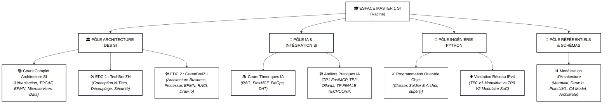

# Master 1 — Architecte des Systèmes d'Information (CFA-INSTA)

Bienvenue dans l'espace de travail et de capitalisation académique du **Master 1 Architecte des Systèmes d'Information**.

Ce dépôt centralise l'ensemble des enseignements théoriques, ateliers pratiques, dossiers d'architecture technique (DAT), études de cas et projets réalisés au sein du **CFA-INSTA**, articulés autour de trois piliers d'expertise complémentaires :

1. **L'Architecture des Systèmes d'Information & Urbanisation d'Entreprise**
2. **L'Intégration de l'Intelligence Artificielle & FastMCP**
3. **L'Ingénierie Logicielle & la Programmation Python**

---

## 📑 Sommaire Général

* [1. Présentation &amp; Profil de l&#39;Étudiant](#1-présentation--profil-de-létudiant)
* [2. Architecture Globale du Dépôt](#2-architecture-globale-du-dépôt)
* [3. Matière 1 : Architecture des Systèmes d&#39;Information (Architecture SI)](#3-matière-1--architecture-des-systèmes-dinformation-architecture-si)
* [4. Matière 2 : Intelligence Artificielle &amp; Systèmes d&#39;Information](#4-matière-2--intelligence-artificielle--systèmes-dinformation)
* [5. Matière 3 : Programmation Python &amp; Ingénierie Logicielle](#5-matière-3--programmation-python--ingénierie-logicielle)
* [6. Référentiels Méthodologiques &amp; Diagrams-as-Code](#6-référentiels-méthodologiques--diagrams-as-code)
* [7. Gouvernance &amp; Bonnes Pratiques du Dépôt](#7-gouvernance--bonnes-pratiques-du-dépôt)

---

## 1. Présentation & Profil de l'Étudiant

* 👤 **[Dossier de Profil : CONTEXTE_ETUDIANT.md](./CONTEXTE_ETUDIANT.md)**
  * **Parcours :** Étudiant au CFA-INSTA en Master 1 Architecte des SI (Logiciel), issu d'un cursus technique complet (BTS SIO SLAM + Titre Concepteur Développeur d'Applications - CDA).
  * **Positionnement académique :** Évolution de la posture de développeur d'applications vers celle d'**Architecte SI**, avec une vision globale des flux d'intégration, de l'urbanisation, de la sécurité (Zero Trust), de la conformité réglementaire (RGPD, EU AI Act, Décret Tertiaire) et des modèles économiques (FinOps, TCO).

---

## 2. Architecture Globale du Dépôt

L'espace de travail est structuré en **4 pôles d'expertise complémentaires** :

### 📊 Tableau Récapitulatif des Pôles

| Pôle d'Expertise                             | Répertoire                           | Contenu & Enjeux Techniques                                                                                                                                                      | Livrables Phares                                                                                                                                                                                                                                                                                                                                                                                                     |
| :-------------------------------------------- | :------------------------------------ | :------------------------------------------------------------------------------------------------------------------------------------------------------------------------------- | :------------------------------------------------------------------------------------------------------------------------------------------------------------------------------------------------------------------------------------------------------------------------------------------------------------------------------------------------------------------------------------------------------------------- |
| **🏛️ 1. Architecture des SI**         | `Matière/Matiere Architecture SI/` | • Urbanisation des SI, TOGAF ADM, Zachman• BPMN 2.0, ArchiMate 3, Microservices, EDA• Clean Architecture, Data Architecture, Zero Trust                                       | • [Cours Complet d&#39;Architecture SI](<./Matière/Matiere%20Architecture%20SI/Cours/COURS_COMPLET_ARCHITECTURE_SI.md>)• [EDC 1 : SI TechBreiZH](<./Matière/Matiere%20Architecture%20SI/TP/Cours%201%20TP/RAPPORT_ETUDE_DE_CAS_TECHBREIZH.md>)• [EDC 2 : Archi Business GreenBreiZH](<./Matière/Matiere%20Architecture%20SI/TP/Cours%202%20TP%20Achitecture%20M%C3%A9tier/RAPPORT_ARCHI_BUSINESS_GREENBREIZH.md>) |
| **🤖 2. IA & Systèmes d'Information**  | `Cours 1.../TP/`                    | • Intégration de LLM dans le SI d'entreprise• Protocoles REST & FastMCP, RAG local• Conformité EU AI Act, FinOps & DAT                                                      | • [TP1 : FastAPI &amp; FastMCP](./TP/TP1/)• [TP2 : IA Souveraine Ollama](./TP/TP2/)• [TP FINALE TECHCORP](./TP/TPFINALE/)                                                                                                                                                                                                                                                                                            |
| **🐍 3. Ingénierie Logicielle Python** | `Matière/Matiere Python/`          | • Algorithmique, flux interactifs & gestion des erreurs• POO (classes, constructeur `__init__`, héritage `super()`)• Architecture modulaire (*Separation of Concerns*) | • [Atelier POO Soldier/Archer](<./Matière/Matiere%20Python/TP/main.py>)• [TP0 V1 (Monolithe)](<./Matière/Matiere%20Python/TP/TP0/Exo1.py>)• [TP0 V2 (Modulaire SoC)](<./Matière/Matiere%20Python/TP/TP0/TP0%20V2/README.md>)                                                                                                                                                                                      |
| **📐 4. Référentiels Transverses**    | `Documentation/`                    | • Standards de modélisation visuelle d'architecture• Comparatif des approches *Diagrams-as-Code*• Étude de cas complète en C4 Model                                      | • [Référentiel Diagrams-as-Code](<./Documentation/Format%20visuel%20diagramme%20schéma/>)                                                                                                                                                                                                                                                                                                                         |

---

### 🗺️ Schéma Visuel de l'Espace de Travail



---

### 📂 Arborescence du Répertoire

```text
📁 Master 1 SI/
├── 📄 README.md                                       # Index général et guide du dépôt
├── 📄 CONTEXTE_ETUDIANT.md                            # Profil et trajectoire académique
│
├── 📁 Matière/
│   ├── 📁 Matiere Architecture SI/                    # 🏛️ Pôle Architecture des SI
│   │   ├── 📁 Cours/
│   │   │   └── 📄 COURS_COMPLET_ARCHITECTURE_SI.md    # Support de cours intégral (9 modules)
│   │   └── 📁 TP/
│   │       ├── 📁 Cours 1 TP/                         # Étude de Cas 1 : TechBreiZH
│   │       │   ├── 📄 EDC1.pdf                        # Sujet officiel CFA INSTA
│   │       │   ├── 📄 EDC1_Rempli.md                  # Sujet complété intégralement
│   │       │   └── 📄 RAPPORT_ETUDE_DE_CAS_TECHBREIZH.md # Rapport d'architecture complet
│   │       └── 📁 Cours 2 TP Achitecture Métier/      # Étude de Cas 2 : GreenBreiZH
│   │           ├── 📄 EDC_Archi_Business.pdf          # Sujet officiel Architecture Métier
│   │           ├── 📄 RAPPORT_ARCHI_BUSINESS_GREENBREIZH.md # Rapport Business & BPMN
│   │           └── 📄 PROCESSUS_BPMN_GREENBREIZH.drawio # Schémas multi-pages éditables
│   │
│   └── 📁 Matiere Python/                             # 🐍 Pôle Ingénierie Python
│       ├── 📄 README.md                               # Manuel complet de la matière
│       └── 📁 TP/                                     # Scripts et ateliers de code
│           ├── 📄 main.py                             # Atelier POO (Soldier, Archer)
│           ├── 📁 TP0/                                # Validation IPv4 (V1 Monolithe)
│           │   └── 📁 TP0 V2/                         # Validation IPv4 (V2 Modulaire SoC)
│           └── 📁 TP1/                                # Modules et packages
│
├── 📁 Cours 1. Connecter l’IA aux SI.../              # 🤖 Pôle IA & Systèmes d'Information
│   ├── 🏆 SYNTHESE_COMPLETE_ACQUIS_TP1_ET_TP2.md      # Synthèse globale des acquis
│   ├── ⚡ FICHES_MEMO_REVISION_RAPIDE_TP1_TP2.md       # 8 fiches mémo visuelles
│   └── ⭐ COURS_SIMPLIFIE_ET_RESUME.md                # Résumé complet du cours
│
├── 📁 TP/                                             # 🤖 Ateliers Pratiques IA
│   ├── 📁 TP1/                                        # FastAPI, FastMCP & Wireshark
│   ├── 📁 TP2/                                        # Ollama, RAG documentaire & Docker
│   └── 📁 TPFINALE/                                   # Assistant TECHCORP
│
└── 📁 Documentation/                                  # 📐 Référentiels Transverses
    └── 📁 Format visuel diagramme schéma/             # Guide Diagrams-as-Code & C4 Model
```

---

## 3. Matière 1 : Architecture des Systèmes d'Information (Architecture SI)

Ce cursus forme à la gouvernance, à l'urbanisation et à la conception modulaire des grands systèmes d'information d'entreprise.

### 📚 Cours Magistral de Référence

* 📘 **[COURS_COMPLET_ARCHITECTURE_SI.md](<./Matière/Matiere%20Architecture%20SI/Cours/COURS_COMPLET_ARCHITECTURE_SI.md>)** : Grand référentiel académique et professionnel articulé en **9 modules** :
  1. *Fondements et Enjeux du SI (Alignement Métier-IT, TCO, Dette Technique).*
  2. *Méthodologies & Cadres (Urbanisation française, TOGAF ADM, Zachman, ISO 42010).*
  3. *Modélisation du SI (BPMN 2.0, ArchiMate 3.x, les 4 Vues Canoniques).*
  4. *Paradigmes Logiciels (Monolithe vs Microservices, SOA, EDA, CQRS, Clean Architecture).*
  5. *Architecture des Données (MDM, CAP, ACID vs BASE, Data Lakehouse, Data Mesh).*
  6. *Architecture d'Intégration (APIs REST, GraphQL, gRPC, API Gateway, Service Mesh).*
  7. *Infrastructure, Cloud & Sécurité (IaaS/PaaS/SaaS, Zero Trust NIST SP 800-207).*
  8. *Gouvernance, Schéma Directeur (SDSI) et Matrice TIME du Gartner.*
  9. *Cas pratique fil conducteur BankNova et questions d'examen corrigées.*

### 🛠️ Travaux Pratiques & Études de Cas Réalisées

* 📁 **[Cours 1 TP : Étude de Cas TechBreiZH (E-Commerce SI)](<./Matière/Matiere%20Architecture%20SI/TP/Cours%201%20TP/>)**
  * 📄 **[RAPPORT_ETUDE_DE_CAS_TECHBREIZH.md](<./Matière/Matiere%20Architecture%20SI/TP/Cours%201%20TP/RAPPORT_ETUDE_DE_CAS_TECHBREIZH.md>)** : Rapport complet d'architecture (identification des composants, séparation en 3 couches, découplage API, microservices, scalabilité horizontale Kubernetes, sécurité PCI-DSS et schéma global).
  * 📄 **[EDC1_Rempli.md](<./Matière/Matiere%20Architecture%20SI/TP/Cours%201%20TP/EDC1_Rempli.md>)** : Sujet de TP complété sous chaque question en phrases simples et directes.
* 📁 **[Cours 2 TP : Étude de Cas GreenBreiZH (Architecture Métier / Business)](<./Matière/Matiere%20Architecture%20SI/TP/Cours%202%20TP%20Achitecture%20M%C3%A9tier/>)**
  * 📄 **[RAPPORT_ARCHI_BUSINESS_GREENBREIZH.md](<./Matière/Matiere%20Architecture%20SI/TP/Cours%202%20TP%20Achitecture%20M%C3%A9tier/RAPPORT_ARCHI_BUSINESS_GREENBREIZH.md>)** : Livrable complet structuré en 4 parties conformes au sujet :
    1. *Document d'Objectifs et de Stratégie Métier (Satisfaction, conformité, SaaS, différenciation).*
    2. *Diagrammes des Processus Métier en BPMN (Suivi temps réel, Recommandations IA, Conformité).*
    3. *Matrice des Rôles et Responsabilités RACI rédigée sans tableau.*
    4. *Catalogue des Services Métier (Valeur ajoutée, modes d'accès).*
  * 📊 **[PROCESSUS_BPMN_GREENBREIZH.drawio](<./Matière/Matiere%20Architecture%20SI/TP/Cours%202%20TP%20Achitecture%20M%C3%A9tier/PROCESSUS_BPMN_GREENBREIZH.drawio>)** : Fichier Draw.io multi-pages éditable contenant les 3 processus BPMN.

---

## 4. Matière 2 : Intelligence Artificielle & Systèmes d'Information

Ce cursus traite de l'interconnexion sécurisée entre modèles d'intelligence artificielle et systèmes d'information d'entreprise.

### 📚 Supports de Cours & Synthèses

* 📁 **[Cours 1 : Connecter l’IA aux Systèmes d’Information](<./Cours%201.%20Connecter%20l’intelligence%20artificielle%20aux%20systèmes%20d’information%2014092026/>)**
  * 🏆 **[SYNTHESE_COMPLETE_ACQUIS_TP1_ET_TP2.md](<./Cours%201.%20Connecter%20l’intelligence%20artificielle%20aux%20systèmes%20d’information%2014092026/SYNTHESE_COMPLETE_ACQUIS_TP1_ET_TP2.md>)** : Synthèse d'architecture capitalisant l'ensemble des acquis pratiques.
  * ⚡ **[FICHES_MEMO_REVISION_RAPIDE_TP1_TP2.md](<./Cours%201.%20Connecter%20l’intelligence%20artificielle%20aux%20systèmes%20d’information%2014092026/FICHES_MEMO_REVISION_RAPIDE_TP1_TP2.md>)** : 8 fiches mémo visuelles de révision rapide.
  * ⭐ **[COURS_SIMPLIFIE_ET_RESUME.md](<./Cours%201.%20Connecter%20l’intelligence%20artificielle%20aux%20systèmes%20d’information%2014092026/COURS_SIMPLIFIE_ET_RESUME.md>)** : Urbanisme, protocoles MCP, agents autonomes, FinOps et cadre réglementaire EU AI Act.

### 🛠️ Projets & Ateliers Pratiques (TP)

* 📁 **[TP / TP1 : Protocoles HTTP, API REST et Serveurs MCP](./TP/TP1/)**
  * 📘 **[Compte-Rendu d&#39;Atelier TP1](./TP/TP1/doc/COMPTE_RENDU_TP1_QUESTIONS_REPONSES.md)**
  * *Technologies :* FastAPI, FastMCP, Wireshark, client HTTP.
* 📁 **[TP / TP2 : Assistant IA Métier Local &amp; Souverain](./TP/TP2/)**
  * 📘 **[Compte-Rendu d&#39;Atelier TP2](./TP/TP2/TP2_FIL_ROUGE_ASSISTANT_IA_LOCAL_REPONSES_COMPLETES.md)**
  * *Technologies :* Inférence locale Ollama (Qwen2.5 7B), Modelfile, RAG documentaire, adaptation LoRA, Docker Compose.
* 📁 **[TP / TP FINALE : Assistant d&#39;Exploitation Connecté (TECHCORP)](./TP/TPFINALE/)**
  * 📘 **[Guide d&#39;Architecture &amp; Étapes du Projet](./TP/TPFINALE/Documentation/GUIDE_ETAPES_PROJET_FINAL.md)**
  * *Technologies :* Base SQL, microservice FastAPI, passerelle FastMCP, IHM Streamlit, supervision d'infrastructure.

---

## 5. Matière 3 : Programmation Python & Ingénierie Logicielle

Ce cursus consolide la maîtrise de Python pour le développement backend, l'automatisation et l'intégration d'architectures orientées services.

### 📚 Manuel & Documentations Dédiées

* 📁 **[Matière / Matière Python](<./Matière/Matiere%20Python/README.md>)** : Manuel complet du module (bonnes pratiques PEP 8, POO, architecture modulaire).
* 📁 **[Index des Travaux Pratiques Python](<./Matière/Matiere%20Python/TP/README.md>)** : Répertoire des scripts et ateliers.

### 🛠️ Ateliers de Code Réalisés

1. **Atelier Programmation Orientée Objet (POO) :**
   * Fichier source : [TP/main.py](<./Matière/Matiere%20Python/TP/main.py>)
   * Implémentation des classes `Soldier` et `Archer(Soldier)`, respect du constructeur `__init__`, encapsulation d'état et factorisation par `super().__init__()`.
2. **Atelier Validation Réseau IPv4 :**
   * Approche monolithique (V1) : [TP0/Exo1.py](<./Matière/Matiere%20Python/TP/TP0/Exo1.py>).
   * Approche modulaire découplée (V2) : 📘 **[Documentation Technique TP0 V2](<./Matière/Matiere%20Python/TP/TP0/TP0%20V2/README.md>)** avec le module métier [reseau.py](<./Matière/Matiere%20Python/TP/TP0/TP0%20V2/reseau.py>) et le client [main.py](<./Matière/Matiere%20Python/TP/TP0/TP0%20V2/main.py>).
3. **Organisation Modulaire de Code :**
   * Différenciation conceptuelle entre **Script** (exécutable), **Module** (bibliothèque de fonctions) et **Package** (dossier structuré avec `__init__.py`).
   * Atelier d'application [TP1](<./Matière/Matiere%20Python/TP/TP1/>).

---

## 6. Référentiels Méthodologiques & Diagrams-as-Code

* 📁 **[Documentation / Format Visuel Diagramme Schéma](<./Documentation/Format%20visuel%20diagramme%20schéma/>)**
  * Guide de sélection et comparatif des formats *Diagrams-as-Code* (*Mermaid, Draw.io, PlantUML, C4 Model, D2, Graphviz, ArchiMate, BPMN*).
  * Exemples visuels et études de cas d'architecture modélisées sous les différents niveaux C4 (Context, Container, Component, Code).

---

## 7. Gouvernance & Bonnes Pratiques du Dépôt

Pour assurer la qualité, la pérennité et la lisibilité du dépôt :

* **Sommaire interactif :** Tout document Markdown `.md` débute par un sommaire interactif cliquable avec ancres locales.
* **Standard Markdown intégral :** Tous les rendus sont formalisés sous forme de fichiers Markdown (`.md`) natifs, accompagnés le cas échéant de schémas éditables (`.drawio`).
* **Diagrammes vectoriels natifs :** Les schémas d'architecture utilisent le format **Mermaid.js** (sur fond blanc et texte noir pour une lisibilité optimale) et le format **Draw.io**.
* **Intégrité des liens :** Tous les liens internes utilisent des chemins relatifs vérifiés.
