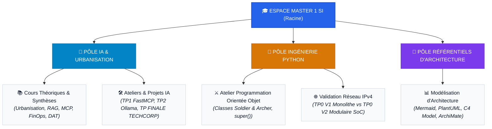

# Master 1 — Architecte des Systèmes d'Information (CFA-INSTA)

Bienvenue dans l'espace de travail et de capitalisation académique du **Master 1 Architecte des Systèmes d'Information**.

Ce dépôt centralise l'ensemble des enseignements théoriques, ateliers pratiques, dossiers d'architecture technique (DAT) et projets réalisés au sein du **CFA-INSTA**, articulés autour de deux pôles d'expertise complémentaires :

1. **L'Urbanisation des SI et l'Intégration de l'Intelligence Artificielle**
2. **L'Ingénierie Logicielle et la Programmation Python**

---

## 📑 Sommaire

* [1. Présentation &amp; Profil de l&#39;Étudiant](#1-présentation--profil-de-létudiant)
* [2. Architecture Globale du Dépôt](#2-architecture-globale-du-dépôt)
* [3. Matière 1 : Intelligence Artificielle &amp; Systèmes d&#39;Information](#3-matière-1--intelligence-artificielle--systèmes-dinformation)
* [4. Matière 2 : Programmation Python &amp; Ingénierie Logicielle](#4-matière-2--programmation-python--ingénierie-logicielle)
* [5. Référentiels Méthodologiques &amp; Diagrams-as-Code](#5-référentiels-méthodologiques--diagrams-as-code)
* [6. Gouvernance &amp; Bonnes Pratiques du Dépôt](#6-gouvernance--bonnes-pratiques-du-dépôt)

---

## 1. Présentation & Profil de l'Étudiant

* 👤 **[Dossier de Profil : CONTEXTE_ETUDIANT.md](./CONTEXTE_ETUDIANT.md)**
  * **Parcours :** Étudiant de 25 ans au CFA-INSTA en Master 1 Architecte des SI (Logiciel), issu d'un cursus technique complet (2 ans de BTS SIO SLAM + 1 an de Titre Concepteur Développeur d'Applications - CDA).
  * **Positionnement académique :** Évolution de la posture de développeur d'applications vers celle d'**Architecte SI**, avec une vision globale des flux d'intégration, de la sécurité, de la conformité réglementaire (EU AI Act) et des modèles de coûts (FinOps).

---

## 2. Architecture Globale du Dépôt

L'espace de travail est structuré en **3 grands pôles complémentaires** :

### 📊 Tableau Récapitulatif des Pôles

| Pôle | Répertoire | Contenu & Enjeux Techniques | Livrables Phares |
| :--- | :--- | :--- | :--- |
| **🤖 1. IA & Urbanisation des SI** | `Cours 1.../`<br>`TP/` | • Intégration de LLM dans le SI d'entreprise<br>• Protocoles REST & FastMCP, RAG local<br>• Conformité EU AI Act, FinOps & DAT | • [TP1 : FastAPI & FastMCP](./TP/TP1/)<br>• [TP2 : IA Souveraine Ollama](./TP/TP2/)<br>• [TP FINALE TECHCORP](./TP/TPFINALE/) |
| **🐍 2. Ingénierie Logicielle Python** | `Matière/` | • Algorithmique, flux interactifs & gestion des erreurs<br>• POO (classes, constructeur `__init__`, héritage `super()`)<br>• Architecture modulaire (*Separation of Concerns*) | • [Atelier POO Soldier/Archer](./Matière/Matiere%20Python/TP/main.py)<br>• [TP0 V1 (Monolithe)](./Matière/Matiere%20Python/TP/TP0/Exo1.py)<br>• [TP0 V2 (Modulaire SoC)](./Matière/Matiere%20Python/TP/TP0/TP0%20V2/README.md) |
| **📐 3. Référentiels Transverses** | `Documentation/` | • Standards de modélisation visuelle d'architecture<br>• Comparatif des approches *Diagrams-as-Code*<br>• Étude de cas complète en C4 Model | • [Référentiel Diagrams-as-Code](./Documentation/Format%20visuel%20diagramme%20schéma/) |

---

### 🗺️ Schéma Visuel de l'Espace de Travail



---

### 📂 Arborescence Simplifiée du Répertoire

```text
📁 Master 1 SI/
├── 📄 README.md                                  # Ce document d'accueil et d'orientation
├── 📄 CONTEXTE_ETUDIANT.md                       # Profil et trajectoire de l'étudiant
│
├── 📁 Cours 1. Connecter l’IA aux SI.../         # 🤖 Cours théoriques d'architecture IA
│   ├── 🏆 SYNTHESE_COMPLETE_ACQUIS_TP1_ET_TP2.md # Synthèse des acquis
│   ├── ⚡ FICHES_MEMO_REVISION_RAPIDE_TP1_TP2.md  # 8 fiches mémo visuelles
│   └── ⭐ COURS_SIMPLIFIE_ET_RESUME.md           # Résumé complet du cours
│
├── 📁 TP/                                        # 🤖 Projets pratiques IA
│   ├── 📁 TP1/                                   # API REST, FastMCP & Wireshark
│   ├── 📁 TP2/                                   # LLM local Ollama, RAG & Docker
│   └── 📁 TPFINALE/                              # Assistant d'exploitation TECHCORP
│
├── 📁 Matière/                                   # 🐍 Ingénierie logicielle & disciplines
│   ├── 📄 README.md                              # Index unifié des 2 matières (IA + Python)
│   └── 📁 Matiere Python/                        # Module de programmation Python
│       ├── 📄 README.md                          # Guide complet de la matière Python
│       └── 📁 TP/                                # Ateliers de code
│           ├── 📄 main.py                        # Atelier POO (Soldier, Archer, super())
│           ├── 📁 TP0/                           # Validation IPv4 (V1 Monolithe)
│           │   └── 📁 TP0 V2/                    # Validation IPv4 (V2 Modulaire SoC)
│           └── 📁 TP1/                           # Organisation en modules et packages
│
└── 📁 Documentation/                             # 📐 Référentiels transverses
    └── 📁 Format visuel diagramme schéma/        # Guide Diagrams-as-Code & C4 Model
```

---

## 3. Matière 1 : Intelligence Artificielle & Systèmes d'Information

Ce cursus traite de l'interconnexion sécurisée entre modèles d'intelligence artificielle et systèmes d'information d'entreprise.

### 📚 Supports de Cours & Synthèses

* 📁 **[Cours 1 : Connecter l’IA aux Systèmes d’Information](<./Cours%201.%20Connecter%20l’intelligence%20artificielle%20aux%20systèmes%20d’information%2014092026/>)**
  * 🏆 **[SYNTHESE_COMPLETE_ACQUIS_TP1_ET_TP2.md](<./Cours%201.%20Connecter%20l’intelligence%20artificielle%20aux%20systèmes%20d’information%2014092026/SYNTHESE_COMPLETE_ACQUIS_TP1_ET_TP2.md>)** : Document maître capitalisant l'intégralité des acquis des ateliers pratiques.
  * ⚡ **[FICHES_MEMO_REVISION_RAPIDE_TP1_TP2.md](<./Cours%201.%20Connecter%20l’intelligence%20artificielle%20aux%20systèmes%20d’information%2014092026/FICHES_MEMO_REVISION_RAPIDE_TP1_TP2.md>)** : Révision condensée en 8 fiches mémo visuelles.
  * ⭐ **[COURS_SIMPLIFIE_ET_RESUME.md](<./Cours%201.%20Connecter%20l’intelligence%20artificielle%20aux%20systèmes%20d’information%2014092026/COURS_SIMPLIFIE_ET_RESUME.md>)** : Principes d'urbanisme, protocoles MCP, agents autonomes, FinOps et conformité.

### 🛠️ Projets & Ateliers Pratiques (TP)

* 📁 **[TP / TP1 : Protocoles HTTP, API REST et Serveurs MCP](./TP/TP1/)**
  * 📘 **[Compte-Rendu d&#39;Atelier TP1](./TP/TP1/doc/COMPTE_RENDU_TP1_QUESTIONS_REPONSES.md)**
  * *Technologies :* FastAPI, FastMCP, Wireshark, client HTTP.
* 📁 **[TP / TP2 : Assistant IA Métier Local &amp; Souverain](./TP/TP2/)**
  * 📘 **[Compte-Rendu d&#39;Atelier TP2](./TP/TP2/TP2_FIL_ROUGE_ASSISTANT_IA_LOCAL_REPONSES_COMPLETES.md)**
  * *Technologies :* Inférence locale Ollama (Qwen2.5 7B), Modelfile, RAG documentaire, adaptation LoRA, Docker Compose.
* 📁 **[TP / TP FINALE : Assistant d&#39;Exploitation Connecté (TECHCORP)](./TP/TPFINALE/)**
  * 📘 **[Guide d&#39;Architecture &amp; Étapes du Projet](./TP/TPFINALE/Documentation/GUIDE_ETAPES_PROJET_FINAL.md)**
  * *Technologies :* Base de données SQL, microservice FastAPI, passerelle FastMCP, IHM Streamlit, supervision d'infrastructure.

---

## 4. Matière 2 : Programmation Python & Ingénierie Logicielle

Ce cursus consolide la maîtrise de Python en tant que langage de développement, d'automatisation et d'intégration d'architectures orientées services.

### 📚 Index & Documentations Dédiées

* 📁 **[Matière / Index des Disciplines](./Matière/README.md)** : Référentiel articulant les deux matières suivies.
* 📁 **[Matière / Matière Python](<./Matière/Matiere%20Python/README.md>)** : Manuel complet du module (bonnes pratiques PEP 8, structures de données, POO, architecture modulaire).
* 📁 **[Index des Travaux Pratiques Python](<./Matière/Matiere%20Python/TP/README.md>)** : Répertoire des scripts et ateliers.

### 🛠️ Ateliers de Code Réalisés

1. **Atelier Programmation Orientée Objet (POO) :**
   * Fichier source : [TP/main.py](<./Matière/Matiere%20Python/TP/main.py>)
   * Implémentation des classes `Soldier` et `Archer(Soldier)`, respect du constructeur *dunder* `__init__`, encapsulation d'état et factorisation par `super().__init__()`.
2. **Atelier Validation Réseau IPv4 :**
   * Approche monolithique (V1) : [TP0/Exo1.py](<./Matière/Matiere%20Python/TP/TP0/Exo1.py>).
   * Approche modulaire découplée (V2) : 📘 **[Documentation Technique TP0 V2](<./Matière/Matiere%20Python/TP/TP0/TP0%20V2/README.md>)** avec le module métier [reseau.py](<./Matière/Matiere%20Python/TP/TP0/TP0%20V2/reseau.py>) et le client d'interaction [main.py](<./Matière/Matiere%20Python/TP/TP0/TP0%20V2/main.py>).
3. **Organisation Modulaire de Code :**
   * Différenciation conceptuelle et technique entre **Script** (exécutable), **Module** (bibliothèque de fonctions) et **Package** (dossier structuré avec `__init__.py`).
   * Consolidation dans l'atelier [TP1](<./Matière/Matiere%20Python/TP/TP1/>).

---

## 5. Référentiels Méthodologiques & Diagrams-as-Code

* 📁 **[Documentation / Format Visuel Diagramme Schéma](<./Documentation/Format%20visuel%20diagramme%20schéma/>)**
  * Guide de sélection et comparatif des formats *Diagrams-as-Code* (*Mermaid, PlantUML, C4 Model, D2, Graphviz, Diagrams Python, DBML, BPMN, ArchiMate*).
  * Exemples visuels et études de cas d'architecture modélisées sous les différents niveaux C4 (Context, Container, Component, Code).

---

## 6. Gouvernance & Bonnes Pratiques du Dépôt

Pour assurer la qualité, la pérennité et la lisibilité du dépôt :

* **Sommaire interactif :** Tout document Markdown `.md` débute par un sommaire interactif cliquable avec ancres locales.
* **Documentation par répertoire :** Chaque sous-dossier intègre son propre fichier `README.md` décrivant sa raison d'être, ses fichiers et ses commandes d'exécution.
* **Diagrammes vectoriels natifs :** Les schémas d'architecture utilisent le format **Mermaid.js** afin d'être lisibles nativement dans les visualiseurs Markdown sans nécessiter d'images externes binaires.
* **Intégrité des liens :** Tous les liens internes utilisent des chemins relatifs validés.
